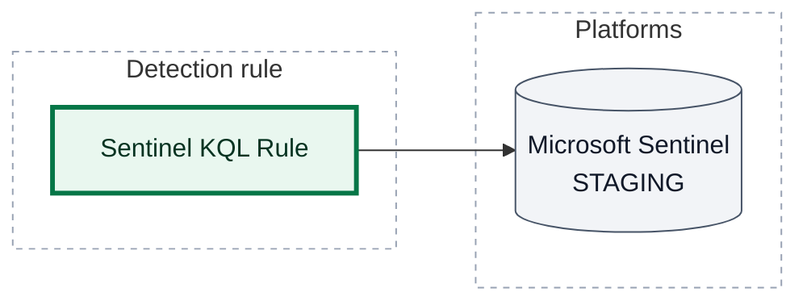
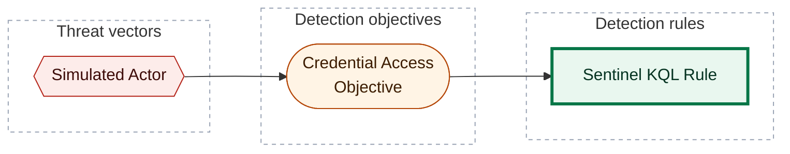

[Catalogue](../README.md) / [Detection rules](README.md)

# Sentinel KQL Rule

*Detection rule · `rule::1.0` · version 1 · modified 2026-01-02 · TLP:CLEAR*

Simulated Sentinel rule for CLI E2E corpus.

| Property | Value |
| --- | --- |
| Severity | High |
| Detection model | [Credential Access Objective](../objectives/credential-access-objective.md) |
| ATT&CK | [`T1059`](https://attack.mitre.org/techniques/T1059) Command and Scripting Interpreter |
| Platforms | Microsoft Sentinel: `STAGING` (PREVIEW runs) |

**On this page:** [Deployment](#deployment) · [Platform configuration](#platform-configuration) · [Response](#response) · [ATT&CK techniques](#att-ck-techniques) · [Detection coverage](#detection-coverage) · [Metadata](#metadata)

## Deployment

What `opentide deploy` does with this rule: each platform block's status, the runs that act on it, and the tenants they reach.

| Platform | Status | Deployed by | Tenants | Block enabled |
| --- | --- | --- | --- | --- |
| Microsoft Sentinel | `STAGING` | PREVIEW runs | no tenant configured | yes |

- `STAGING` (strategy `PREVIEW`): Deployed in staging environment for operational testing

> **Warning:** Microsoft Sentinel configures no tenant: a run that deploys this block fails until one is added to the platform file.



*Shapes:* rectangle = detection rule; cylinder = platform; bold outline = this page. *Lines:* solid line = deployed, by the runs named on the line.

## Platform configuration

### Microsoft Sentinel

Status `STAGING` · deployed by PREVIEW runs · tenants: no tenant configured

**`query`** (KQL)

```kql
SecurityEvent
| where EventID == 4688
| take 1
```

| Setting | Value | Description |
| --- | --- | --- |
| `name` | Sentinel KQL Rule | Platform-specific rule name. |
| `scheduling.frequency` | `PT1H` | Duration: ISO 8601, or shorthand converted to ISO 8601. |
| `scheduling.lookback` | `PT2H` | Duration: ISO 8601, or shorthand converted to ISO 8601. |
| `alert.title` | Sentinel KQL Rule | Alert display-name format. |
| `alert.suppression` | `false` | `false` disables suppression and sends a one-hour duration. |
| `alert.create_incident` | `true` *(default)* | Whether a firing alert opens an incident. |
| `grouping.event` | `SingleAlert` | Sentinel `aggregationKind`. `SingleAlert` groups events into one alert. `AlertPerResult` emits one alert per row. |
| `grouping.alert.enabled` | `false` | Group alerts into one incident. |

## Response

| Property | Value |
| --- | --- |
| Alert severity | High |

## ATT&CK techniques

| Technique | Name | Tactics | Summary |
| --- | --- | --- | --- |
| [`T1059`](https://attack.mitre.org/techniques/T1059) | Command and Scripting Interpreter | Execution | Adversaries may abuse command and script interpreters to execute commands, scripts, or binaries. |

## Detection coverage



*Shapes:* hexagon = threat vector; stadium = detection objective; rectangle = detection rule; bold outline = this page.

### Related objects

| Type | Object | Direction |
| --- | --- | --- |
| Threat | [Simulated Actor](../threats/simulated-actor.md) | Upstream |
| Objective | [Credential Access Objective](../objectives/credential-access-objective.md) | Upstream |

## Metadata

| Field | Value |
| --- | --- |
| UUID | `00000000-0000-4000-8003-000000000001` |
| Schema | `rule::1.0` |
| Version | `1` |
| Created | `2026-01-01` |
| Modified | `2026-01-02` |
| TLP | clear (`TLP:CLEAR`) |

<!-- Generated by opentide (opentide generate docs). Edit the object's YAML instead: this page is rewritten on every run. -->
