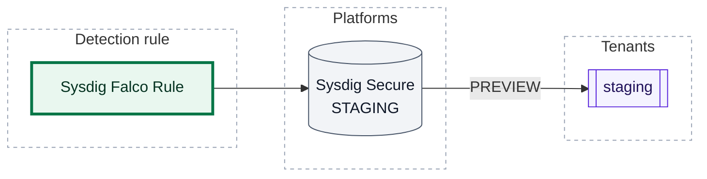
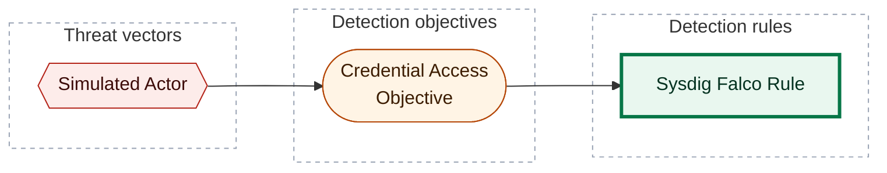

[Catalogue](../README.md) / [Detection rules](README.md)

# Sysdig Falco Rule

*Detection rule · `rule::1.0` · version 1 · modified 2026-01-02 · TLP:CLEAR*

Simulated Sysdig Secure Falco rule for CLI E2E corpus: a shell spawned in
a container.

| Property | Value |
| --- | --- |
| Severity | Medium |
| Detection model | [Credential Access Objective](../objectives/credential-access-objective.md) |
| ATT&CK | [`T1059.004`](https://attack.mitre.org/techniques/T1059/004) Command and Scripting Interpreter: Unix Shell |
| Platforms | Sysdig Secure: `STAGING` (PREVIEW runs) |

**On this page:** [Deployment](#deployment) · [Platform configuration](#platform-configuration) · [Response](#response) · [ATT&CK techniques](#att-ck-techniques) · [Detection coverage](#detection-coverage) · [Metadata](#metadata)

## Deployment

What `opentide deploy` does with this rule: each platform block's status, the runs that act on it, and the tenants they reach.

| Platform | Status | Deployed by | Tenants | Block enabled |
| --- | --- | --- | --- | --- |
| Sysdig Secure | `STAGING` | PREVIEW runs | `staging` | yes |

- `STAGING` (strategy `PREVIEW`): Deployed in staging environment for operational testing



*Shapes:* rectangle = detection rule; cylinder = platform; subroutine box = tenant; bold outline = this page. *Lines:* solid line = deployed, by the runs named on the line.

### Tenant targeting

| Platform | Tenant | Reached by | Remote ID |
| --- | --- | --- | --- |
| Sysdig Secure | `staging` | PREVIEW runs | - |

## Platform configuration

### Sysdig Secure

Status `STAGING` · deployed by PREVIEW runs · tenants: `staging` · schema `platform::sysdig::1.0`

**`condition`** (Falco condition)

```text
spawned_process and container and proc.name in (corpus_shells)
```

| Setting | Value | Description |
| --- | --- | --- |
| `tags` | `container`, `shell` | Extra Falco tags. |

**`lists`**: Lists only this rule uses, expanded into the condition at deploy.

| `name` | `items` |
| --- | --- |
| `corpus_shells` | `bash`, `sh`, `zsh` |

## Response

| Property | Value |
| --- | --- |
| Alert severity | Medium |

## ATT&CK techniques

| Technique | Name | Tactics | Summary |
| --- | --- | --- | --- |
| [`T1059.004`](https://attack.mitre.org/techniques/T1059/004) | Command and Scripting Interpreter: Unix Shell | Execution | Adversaries may abuse Unix shell commands and scripts for execution. |

## Detection coverage



*Shapes:* hexagon = threat vector; stadium = detection objective; rectangle = detection rule; bold outline = this page.

### Related objects

| Type | Object | Direction |
| --- | --- | --- |
| Threat | [Simulated Actor](../threats/simulated-actor.md) | Upstream |
| Objective | [Credential Access Objective](../objectives/credential-access-objective.md) | Upstream |

## Metadata

| Field | Value |
| --- | --- |
| UUID | `00000000-0000-4000-8003-0000005d1a90` |
| Schema | `rule::1.0` |
| Version | `1` |
| Created | `2026-01-01` |
| Modified | `2026-01-02` |
| TLP | clear (`TLP:CLEAR`) |

<!-- Generated by opentide (opentide generate docs). Edit the object's YAML instead: this page is rewritten on every run. -->
