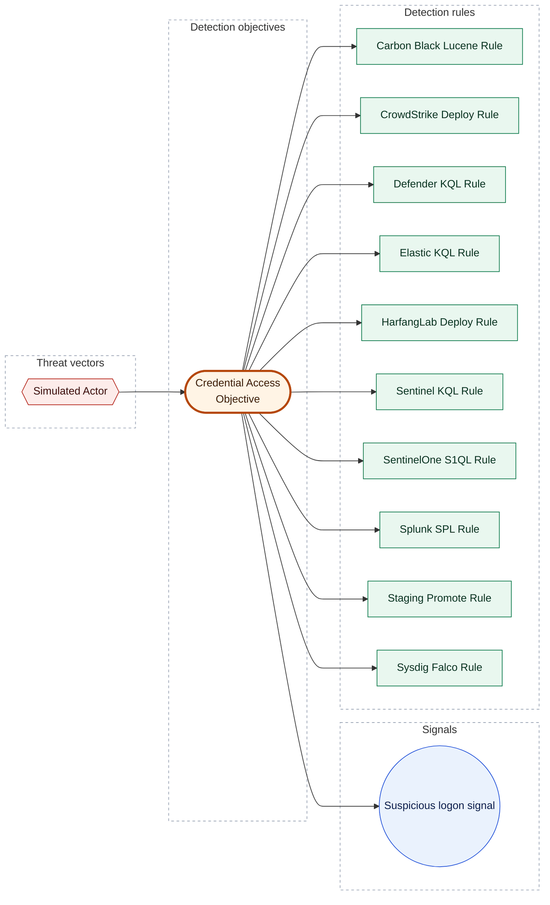

[Catalogue](../README.md) / [Detection objectives](README.md)

# Credential Access Objective

*Detection objective · `objective::1.0` · version 1 · modified 2026-01-02 · TLP:CLEAR*

Detect credential access techniques

| Property | Value |
| --- | --- |
| Priority | High |
| Type | Threat |
| Composition | Combined |
| Threats addressed | [Simulated Actor](../threats/simulated-actor.md) |
| Signals | 1 signal |
| Detection rules | 10 rules |
| Platforms | Carbon Black Cloud, CrowdStrike Falcon, Elastic Security, HarfangLab, Microsoft Defender for Endpoint, Microsoft Sentinel, SentinelOne, Splunk Enterprise Security, Sysdig Secure |

> [!WARNING]
> 1 of 1 signal has no implementing rule yet: *Suspicious logon signal*.

**On this page:** [Composition](#composition) · [Threats addressed](#threats-addressed) · [Signals](#signals) · [Detection coverage](#detection-coverage) · [Metadata](#metadata)

## Composition

**Combined**: All signals triggered for any entity can be grouped in a single signal. This may be extremely useful to identify pan-environment compromises.

Compose signals for credential access detection

## Threats addressed

| Threat vector | Criticality | Kill chain |
| --- | --- | --- |
| [Simulated Actor](../threats/simulated-actor.md) | High | - |

## Signals

| Signal | Severity | Methodology | Effort | Rules | Platforms and status |
| --- | --- | --- | --- | --- | --- |
| [Suspicious logon signal](#suspicious-logon-signal) | Medium | Statistical | - | *None yet* | - |
| *Objective as a whole* | - | - | - | [Carbon Black Lucene Rule](../rules/carbon-black-lucene-rule.md) [CrowdStrike Deploy Rule](../rules/crowdstrike-deploy-rule.md) [Defender KQL Rule](../rules/defender-kql-rule.md) [Elastic KQL Rule](../rules/elastic-kql-rule.md) [HarfangLab Deploy Rule](../rules/harfanglab-deploy-rule.md) [Sentinel KQL Rule](../rules/sentinel-kql-rule.md) [SentinelOne S1QL Rule](../rules/sentinelone-s1ql-rule.md) [Splunk SPL Rule](../rules/splunk-spl-rule.md) [Staging Promote Rule](../rules/staging-promote-rule.md) [Sysdig Falco Rule](../rules/sysdig-falco-rule.md) | Carbon Black Cloud `STAGING` CrowdStrike Falcon `STAGING` Microsoft Defender for Endpoint `STAGING` Elastic Security `STAGING` HarfangLab `STAGING` Microsoft Sentinel `STAGING` SentinelOne `STAGING` Splunk Enterprise Security `STAGING` Microsoft Sentinel `STAGING` Sysdig Secure `STAGING` |

### Suspicious logon signal

Suspicious authentication activity

- **Data:** Complete. Security event logs
- **Entities:** Hostname
- **Implemented by:** *no rule yet*
- **UUID:** `00000000-0000-4000-8099-000000000001`

## Detection coverage

*Shapes:* hexagon = threat vector; stadium = detection objective; circle = detection signal; rectangle = detection rule; bold outline = this page.

### Related objects

| Type | Object | Direction |
| --- | --- | --- |
| Threat | [Simulated Actor](../threats/simulated-actor.md) | Upstream |
| Signal | [Suspicious logon signal](credential-access-objective.md#suspicious-logon-signal) | Downstream |
| Rule | [Carbon Black Lucene Rule](../rules/carbon-black-lucene-rule.md) | Downstream |
| Rule | [CrowdStrike Deploy Rule](../rules/crowdstrike-deploy-rule.md) | Downstream |
| Rule | [Defender KQL Rule](../rules/defender-kql-rule.md) | Downstream |
| Rule | [Elastic KQL Rule](../rules/elastic-kql-rule.md) | Downstream |
| Rule | [HarfangLab Deploy Rule](../rules/harfanglab-deploy-rule.md) | Downstream |
| Rule | [Sentinel KQL Rule](../rules/sentinel-kql-rule.md) | Downstream |
| Rule | [SentinelOne S1QL Rule](../rules/sentinelone-s1ql-rule.md) | Downstream |
| Rule | [Splunk SPL Rule](../rules/splunk-spl-rule.md) | Downstream |
| Rule | [Staging Promote Rule](../rules/staging-promote-rule.md) | Downstream |
| Rule | [Sysdig Falco Rule](../rules/sysdig-falco-rule.md) | Downstream |

## Metadata

| Field | Value |
| --- | --- |
| UUID | `00000000-0000-4000-8002-000000000001` |
| Schema | `objective::1.0` |
| Version | `1` |
| Created | `2026-01-01` |
| Modified | `2026-01-02` |
| TLP | clear (`TLP:CLEAR`) |

<!-- Generated by opentide (opentide generate docs). Edit the object's YAML instead: this page is rewritten on every run. -->
