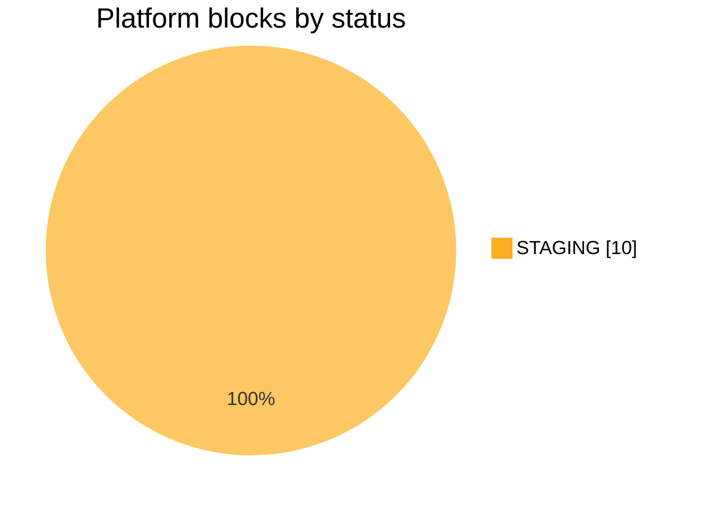
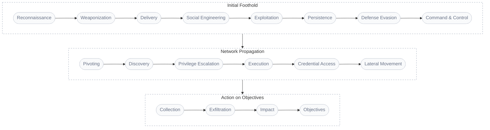

# Detection catalogue

1 threat vector, 1 detection objective and 10 detection rules, documented by opentide from the catalogue's YAML.

```json:table
{"fields":[{"key":"a","label":"Section","sortable":"true"},{"key":"b","label":"Objects","sortable":"true"},{"key":"c","label":"Holds","sortable":"true"}],"items":[{"a":"[Detection rules](rules/README.md)","b":"10","c":"Deployable queries, where they run and at which status"},{"a":"[Detection objectives](objectives/README.md)","b":"1","c":"What to detect about a threat, as signals rules implement"},{"a":"[Threat vectors](threats/README.md)","b":"1","c":"Adversary behaviours, assessed, chained and covered"}],"filter":"true","markdown":"true","sortable":"true"}
```

## Deployment status



| Platform | `STAGING` | Total |
| --- | --- | --- |
| Carbon Black Cloud | 1 | 1 |
| CrowdStrike Falcon | 1 | 1 |
| Elastic Security | 1 | 1 |
| HarfangLab | 1 | 1 |
| Microsoft Defender for Endpoint | 1 | 1 |
| Microsoft Sentinel | 2 | 2 |
| SentinelOne | 1 | 1 |
| Splunk Enterprise Security | 1 | 1 |
| Sysdig Secure | 1 | 1 |

## Coverage

| Measure | Value |
| --- | --- |
| Threat vectors addressed by an objective | 1 of 1 (100%) |
| Objectives implemented by a rule | 1 of 1 (100%) |
| Signals implemented by a rule | 0 of 1 (0%) |
| ATT&CK techniques detected by rules | 2 |

### Kill-chain coverage



*Shapes:* stadium = kill-chain phase. *Colours:* grey = no threat vector.

| Kill-chain phase | Stage | Threat vectors | Addressed by an objective | Coverage |
| --- | --- | --- | --- | --- |
| *No phase* | - | 1 | 1 | 100% |

### ATT&CK coverage

| Tactic | Techniques in threat vectors | Detected by a rule | Coverage | Not detected |
| --- | --- | --- | --- | --- |
| Execution | 1 | 1 | 100% | - |

<!-- Generated by opentide (opentide generate docs). Edit the object's YAML instead: this page is rewritten on every run. -->
