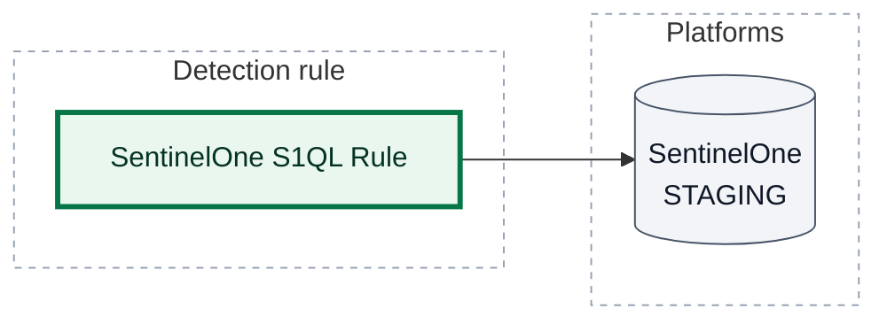
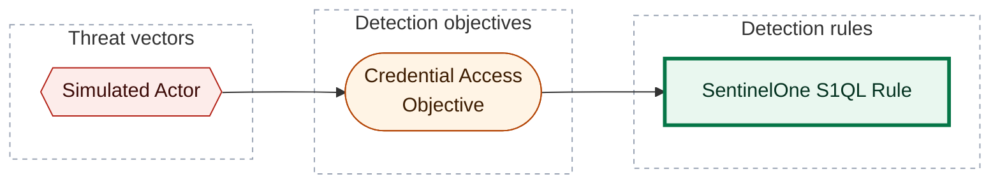

[Catalogue](../README) / [Detection rules](README)

*Detection rule · `rule::1.0` · version 1 · modified 2026-01-02 · TLP:CLEAR*

Simulated SentinelOne rule for CLI E2E corpus.

| Property | Value |
| --- | --- |
| Severity | High |
| Detection model | [Credential Access Objective](../objectives/00000000-0000-4000-8002-000000000001) |
| ATT&CK | [`T1059`](https://attack.mitre.org/techniques/T1059) Command and Scripting Interpreter |
| Platforms | SentinelOne: `STAGING` (PREVIEW runs) |

[[_TOC_]]

## Deployment

What `opentide deploy` does with this rule: each platform block's status, the runs that act on it, and the tenants they reach.

| Platform | Status | Deployed by | Tenants | Block enabled |
| --- | --- | --- | --- | --- |
| SentinelOne | `STAGING` | PREVIEW runs | no tenant configured | yes |

- `STAGING` (strategy `PREVIEW`): Deployed in staging environment for operational testing

> **Warning:** SentinelOne configures no tenant: a run that deploys this block fails until one is added to the platform file.



*Shapes:* rectangle = detection rule; cylinder = platform; bold outline = this page. *Lines:* solid line = deployed, by the runs named on the line.

## Platform configuration

### SentinelOne

Status `STAGING` · deployed by PREVIEW runs · tenants: no tenant configured

**`condition.correlation.sub_queries[0].query`** (S1QL): S1QL sub-query.

```sql
EventType = "Process Create"
```

| Setting | Value | Description |
| --- | --- | --- |
| `name` | SentinelOne S1QL Rule | Platform-specific rule name. |
| `condition.type` | `Correlation` | `Single Event` or `Correlation`. |
| `condition.correlation.entity` | `host` | Entity the sub-queries correlate on (`host`, `user`, …). |
| `condition.correlation.match_in_order` | `true` | Whether sub-queries must match in list order. |
| `condition.correlation.time_window` | `1h` | Correlation window (`1h`, `30m`). |
| `condition.correlation.sub_queries[0].matches_required` | `1` | Number of matches this sub-query needs within the correlation window. |
| `response.treat_as_threat` | `Malicious` | `false` is sent as `UNDEFINED`. |
| `response.network_quarantine` | `false` | Quarantine the endpoint from the network. |

## Response

| Property | Value |
| --- | --- |
| Alert severity | High |

## ATT&CK techniques

| Technique | Name | Tactics | Summary |
| --- | --- | --- | --- |
| [`T1059`](https://attack.mitre.org/techniques/T1059) | Command and Scripting Interpreter | Execution | Adversaries may abuse command and script interpreters to execute commands, scripts, or binaries. |

## Detection coverage



*Shapes:* hexagon = threat vector; stadium = detection objective; rectangle = detection rule; bold outline = this page.

### Related objects

| Type | Object | Direction |
| --- | --- | --- |
| Threat | [Simulated Actor](../threats/00000000-0000-4000-8001-000000000001) | Upstream |
| Objective | [Credential Access Objective](../objectives/00000000-0000-4000-8002-000000000001) | Upstream |

## Metadata

| Field | Value |
| --- | --- |
| UUID | `00000000-0000-4000-8003-000000000004` |
| Schema | `rule::1.0` |
| Version | `1` |
| Created | `2026-01-01` |
| Modified | `2026-01-02` |
| TLP | clear (`TLP:CLEAR`) |

<!-- Generated by opentide (opentide generate docs). Edit the object's YAML instead: this page is rewritten on every run. -->
