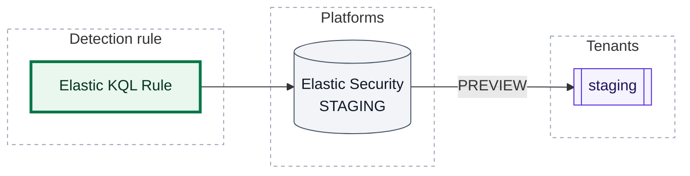
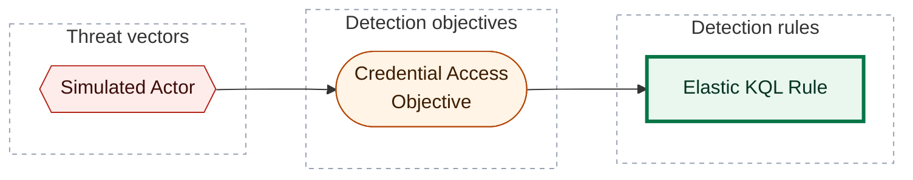

[Catalogue](../README) / [Detection rules](README)

*Detection rule · `rule::1.0` · version 1 · modified 2026-01-02 · TLP:CLEAR*

Simulated Elastic rule for CLI E2E corpus.

| Property | Value |
| --- | --- |
| Severity | High |
| Detection model | [Credential Access Objective](../objectives/00000000-0000-4000-8002-000000000001) |
| ATT&CK | [`T1059`](https://attack.mitre.org/techniques/T1059) Command and Scripting Interpreter |
| Platforms | Elastic Security: `STAGING` (PREVIEW runs) |

[[_TOC_]]

## Deployment

What `opentide deploy` does with this rule: each platform block's status, the runs that act on it, and the tenants they reach.

| Platform | Status | Deployed by | Tenants | Block enabled |
| --- | --- | --- | --- | --- |
| Elastic Security | `STAGING` | PREVIEW runs | `staging` | yes |

- `STAGING` (strategy `PREVIEW`): Deployed in staging environment for operational testing



*Shapes:* rectangle = detection rule; cylinder = platform; subroutine box = tenant; bold outline = this page. *Lines:* solid line = deployed, by the runs named on the line.

### Tenant targeting

| Platform | Tenant | Reached by | Remote ID |
| --- | --- | --- | --- |
| Elastic Security | `staging` | PREVIEW runs | - |

## Platform configuration

### Elastic Security

Status `STAGING` · deployed by PREVIEW runs · tenants: `staging` · schema `platform::elastic::1.0`

**`query`** (Kibana KQL): The event query, in the language the type selects.

```kql
process.name: "powershell.exe"
```

| Setting | Value | Description |
| --- | --- | --- |
| `type` | `query` | Rule type: `query`, `eql`, `esql`, `threshold`, `new_terms`, `threat_match` or `machine_learning`. |
| `language` | `kuery` | `kuery` (KQL) or `lucene`, for the event query of `query`, `threshold`, `new_terms`, and `threat_match`. |
| `index` | `logs-*` | Index patterns. |
| `scheduling.interval` | `5m` | Runs every. |
| `scheduling.lookback` | `1m` | Additional look-back time. `0m` is valid. |
| `building_block` | `false` *(default)* | Building block rule: alerts are hidden from the default Alerts view. |

## Response

| Property | Value |
| --- | --- |
| Alert severity | High |

## ATT&CK techniques

| Technique | Name | Tactics | Summary |
| --- | --- | --- | --- |
| [`T1059`](https://attack.mitre.org/techniques/T1059) | Command and Scripting Interpreter | Execution | Adversaries may abuse command and script interpreters to execute commands, scripts, or binaries. |

## Detection coverage



*Shapes:* hexagon = threat vector; stadium = detection objective; rectangle = detection rule; bold outline = this page.

### Related objects

| Type | Object | Direction |
| --- | --- | --- |
| Threat | [Simulated Actor](../threats/00000000-0000-4000-8001-000000000001) | Upstream |
| Objective | [Credential Access Objective](../objectives/00000000-0000-4000-8002-000000000001) | Upstream |

## Metadata

| Field | Value |
| --- | --- |
| UUID | `00000000-0000-4000-8003-000000000009` |
| Schema | `rule::1.0` |
| Version | `1` |
| Created | `2026-01-01` |
| Modified | `2026-01-02` |
| TLP | clear (`TLP:CLEAR`) |

<!-- Generated by opentide (opentide generate docs). Edit the object's YAML instead: this page is rewritten on every run. -->
