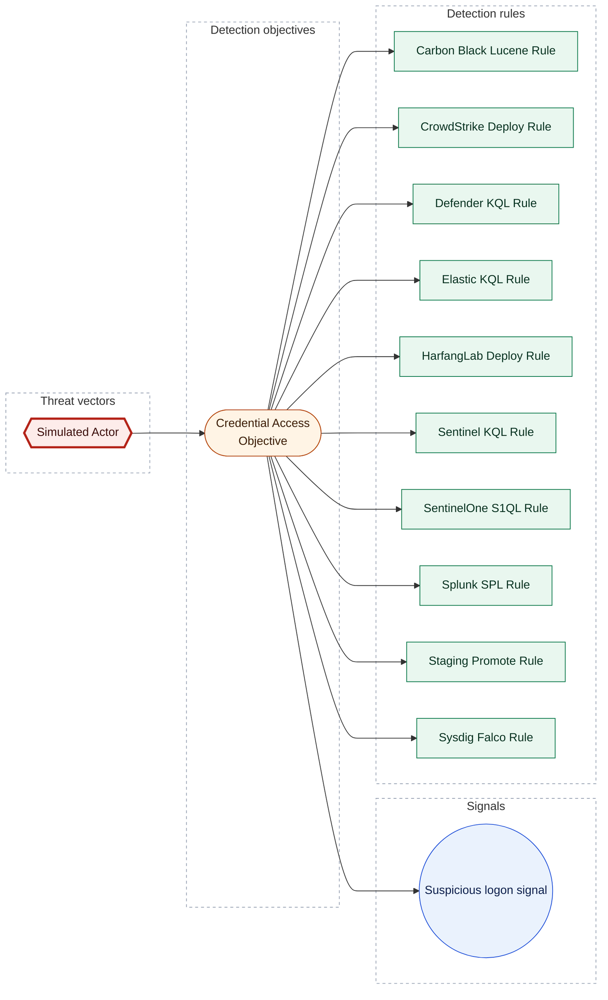

[Catalogue](../README) / [Threat vectors](README)

*Threat vector · `threat::1.0` · version 1 · modified 2026-01-02 · TLP:CLEAR*

Simulated threat actor for CLI E2E corpus

| Property | Value |
| --- | --- |
| Criticality | High |
| Severity | Substantial incident |
| Surface | Windows::Desktop |
| Actors | [Enterprise] APT1 |
| ATT&CK | [`T1059`](https://attack.mitre.org/techniques/T1059) Command and Scripting Interpreter |
| Detection coverage | 1 objective, 10 rules |

[[_TOC_]]

## Assessment

**Criticality: High**. A High priority incident is likely to result in a demonstrable impact to public health or safety, national security, economic security, foreign relations, civil liberties, or public confidence.

**Terrain:** Endpoint workstations and user devices.

| Dimension | Assessment | Description |
| --- | --- | --- |
| Severity | Substantial incident | A cyber attack which has a serious impact on a medium-sized organisation, or which poses a considerable risk to a large organisation or wider / local government. |
| Impact | Data Breach Identity Theft | Non-public information has been accessed from the outside, and successfully extracted. Acquisition of sufficient information and privileges to profess as a given individual, for the purpose of abusing and deceiving human trust relationships. |
| Leverage | Information Gathering Elevation of privilege | Gathering information about the target system, network, or environment to inform subsequent attack phases. Capacity to augment leverage over the target system by upgrading the compromised access rights |
| Viability | Likely | Probable (probably) - 55-80% |

## Surface

| Surface | Description |
| --- | --- |
| Windows::Desktop | Microsoft Windows desktop editions |

## Actors

| Actor | ID | Source | Description |
| --- | --- | --- | --- |
| [[Enterprise] APT1](https://attack.mitre.org/groups/G0006) *also Comment Crew, Comment Group, Comment Panda* | `att&ck::G0006` | att&ck | [APT1](https://attack.mitre.org/groups/G0006) is a Chinese threat group that has been attributed to the 2nd Bureau of the People’s Liberation Army (PLA) General Staff Department’s (GSD) 3rd Department, commonly known by its Military Unit… |

## ATT&CK techniques

| Technique | Name | Tactics | Detected by | Summary |
| --- | --- | --- | --- | --- |
| [`T1059`](https://attack.mitre.org/techniques/T1059) | Command and Scripting Interpreter | Execution | [Carbon Black Lucene Rule](../rules/00000000-0000-4000-8003-000000000005) [CrowdStrike Deploy Rule](../rules/00000000-0000-4000-8003-000000000006) [Defender KQL Rule](../rules/00000000-0000-4000-8003-000000000002) [Elastic KQL Rule](../rules/00000000-0000-4000-8003-000000000009) [HarfangLab Deploy Rule](../rules/00000000-0000-4000-8003-000000000007) [Sentinel KQL Rule](../rules/00000000-0000-4000-8003-000000000001) [SentinelOne S1QL Rule](../rules/00000000-0000-4000-8003-000000000004) [Splunk SPL Rule](../rules/00000000-0000-4000-8003-000000000003) [Staging Promote Rule](../rules/00000000-0000-4000-8003-000000000008) [Sysdig Falco Rule](../rules/00000000-0000-4000-8003-0000005d1a90) | Adversaries may abuse command and script interpreters to execute commands, scripts, or binaries. |

## Detection coverage

*Shapes:* hexagon = threat vector; stadium = detection objective; circle = detection signal; rectangle = detection rule; bold outline = this page.

### Related objects

| Type | Object | Direction |
| --- | --- | --- |
| Objective | [Credential Access Objective](../objectives/00000000-0000-4000-8002-000000000001) | Downstream |
| Signal | [Suspicious logon signal](../objectives/00000000-0000-4000-8002-000000000001.md#suspicious-logon-signal) | Downstream |
| Rule | [Carbon Black Lucene Rule](../rules/00000000-0000-4000-8003-000000000005) | Downstream |
| Rule | [CrowdStrike Deploy Rule](../rules/00000000-0000-4000-8003-000000000006) | Downstream |
| Rule | [Defender KQL Rule](../rules/00000000-0000-4000-8003-000000000002) | Downstream |
| Rule | [Elastic KQL Rule](../rules/00000000-0000-4000-8003-000000000009) | Downstream |
| Rule | [HarfangLab Deploy Rule](../rules/00000000-0000-4000-8003-000000000007) | Downstream |
| Rule | [Sentinel KQL Rule](../rules/00000000-0000-4000-8003-000000000001) | Downstream |
| Rule | [SentinelOne S1QL Rule](../rules/00000000-0000-4000-8003-000000000004) | Downstream |
| Rule | [Splunk SPL Rule](../rules/00000000-0000-4000-8003-000000000003) | Downstream |
| Rule | [Staging Promote Rule](../rules/00000000-0000-4000-8003-000000000008) | Downstream |
| Rule | [Sysdig Falco Rule](../rules/00000000-0000-4000-8003-0000005d1a90) | Downstream |

## Metadata

| Field | Value |
| --- | --- |
| UUID | `00000000-0000-4000-8001-000000000001` |
| Schema | `threat::1.0` |
| Version | `1` |
| Created | `2026-01-01` |
| Modified | `2026-01-02` |
| TLP | clear (`TLP:CLEAR`) |

<!-- Generated by opentide (opentide generate docs). Edit the object's YAML instead: this page is rewritten on every run. -->
