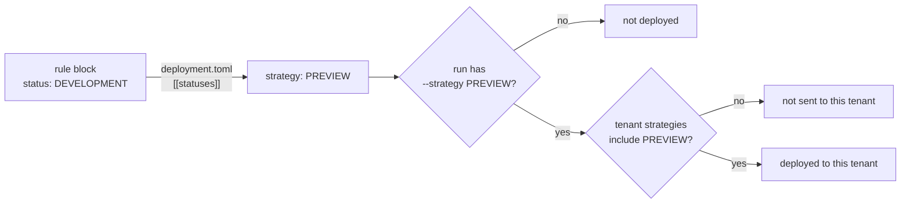

# Statuses, strategies and tenants

Three settings decide what `opentide deploy` sends, and where:

1. **The rule's status** says what stage the rule is at. You choose the status names.
2. **The status's strategy** says what deploy does with a rule at that stage. Each status maps to one strategy, and the strategies are fixed.
3. **The run's `--strategy`** says which strategy this deploy carries out. **The tenant's `strategies`** say which strategies a tenant accepts.

A rule is deployed to a tenant when its status maps to a strategy the run deploys, and the tenant accepts that strategy. Nothing else is involved: a status *name* never decides anything.



## Statuses are yours, and their names mean nothing to deploy

A status is a label on a rule's platform block (`status:` in the YAML). The set of statuses lives in `deployment.toml` `[[statuses]]`, and each one maps to a strategy. opentide ships a default set:

| Default status | Maps to strategy |
|----------------|------------------|
| `DESIGN` | `INERT` |
| `DEVELOPMENT` | `PREVIEW` |
| `IMPROVING` | `PREVIEW` |
| `STAGING` | `PREVIEW` |
| `ACCEPTANCE` | `PREVIEW` |
| `PRODUCTION` | `RELEASE` |
| `DISABLED` | `DISABLEMENT` |
| `REMOVED` | `DELETION` |

These are defaults, not canonical statuses. `STAGING` and `PRODUCTION` are two status names among eight, chosen to read well; they have no special meaning. You can rename them, delete them, or add your own, and deploy behaves exactly as their strategies say:

```toml
# .opentide/configurations/deployment.toml
[[statuses]]
name = "CANARY"
description = "Limited rollout"
strategy = "PREVIEW"     # deployed by PREVIEW runs, like DEVELOPMENT

[[statuses]]
name = "LIVE"
description = "In production"
strategy = "RELEASE"     # deployed by RELEASE runs, like the default PRODUCTION
```

A status called `STAGING` that you map to `RELEASE` is deployed by `RELEASE` runs. opentide never reads a status name as a strategy, or a strategy as a status name.

## Strategies are fixed

| Strategy | What it means | Deployed by |
|----------|---------------|-------------|
| `INERT` | Not deployed anywhere | no run |
| `PREVIEW` | Deploy for review, from pull or merge requests | `--strategy PREVIEW` |
| `RELEASE` | Deploy for real, from the default branch | `--strategy RELEASE` |
| `UNIVERSAL` | Deploy from both | `--strategy PREVIEW` and `--strategy RELEASE` |
| `DISABLEMENT` | Disable the deployed rule (keep it, inactive) | `--strategy RELEASE` |
| `DELETION` | Remove the deployed rule | `--strategy RELEASE` |

A run deploys `PREVIEW`, `RELEASE`, or both. Those are the only values `--strategy` and a tenant's `strategies` take:

- `UNIVERSAL` is a strategy a status can map to, not one a run asks for. Both kinds of run deploy it.
- `DISABLEMENT` and `DELETION` are what a `RELEASE` run does to a retired rule. When you move a rule to `DISABLED` or `REMOVED` and merge, the default-branch `RELEASE` run disables or deletes it.
- `INERT` rules are never deployed.

`opentide deploy --strategy STAGING` fails. The message says `STAGING` is a status name, which strategy it maps to in your configuration, and what to pass instead.

## Which rule files a run reads

A deploy reads the rule files its commits changed, never the whole catalogue unless you ask:

| Where the run is | Rule files read |
|------------------|-----------------|
| Pull or merge request pipeline | Those the request changed, from its merge base |
| Any other CI pipeline (a push to the default branch) | Those the push changed |
| Outside CI | Those the checkout's last commit changed. Uncommitted edits are not read |
| Any of the above, with `--all` | Every rule file |

Only files placed directly in the rules folder are read; a file in a subfolder is never deployed. A deleted rule file is not read: to remove a deployed rule, set it to a status that maps to `DELETION` first.

`--all` leaves out rules that map to `DISABLEMENT` or `DELETION`, so a full redeploy does not retire your archived rules by accident. Pass `--keep-deprecated` to include them. Without `--all` they are included, and `--drop-deprecated` leaves them out.

## Tenants accept strategies

Each tenant in a platform file lists the strategies it accepts:

```toml
# .opentide/configurations/platforms/splunk.toml
[[tenants]]
name = "splunk-test"
strategies = ["PREVIEW"]          # reviewed changes land here first

[[tenants]]
name = "splunk-prod"
strategies = ["RELEASE"]          # merged changes; also disables and deletes retired rules

[[tenants]]
name = "splunk-lab"
manual = true                     # only rules that name it

[[tenants]]
name = "splunk-shared"            # no `strategies`: accepts PREVIEW and RELEASE
```

- `strategies` lists `PREVIEW`, `RELEASE`, or both. Omitted, the tenant accepts both.
- `manual = true` means only the rules whose platform block lists the tenant reach it, still filtered by `strategies`.
- A rule whose platform block lists `tenants` reaches only those tenants, still filtered by `strategies`.

A tenant that accepts `RELEASE` also receives the disables and deletes of a `RELEASE` run. A tenant that only accepts `PREVIEW` keeps its preview copy of a rule you retire. Remove it from that tenant by hand, or give the tenant `RELEASE` too.

## The two generated jobs

`opentide setup ci` writes these two deploy jobs:

| Job | Runs on | Command | Deploys |
|-----|---------|---------|---------|
| `deploy_staging` | Pull or merge request | `opentide deploy --strategy PREVIEW` | The changed rules that map to `PREVIEW` or `UNIVERSAL`, to tenants accepting `PREVIEW` |
| `deploy_production` | Push to the default branch | `opentide deploy --strategy RELEASE` | The changed rules that map to `RELEASE` or `UNIVERSAL`, to tenants accepting `RELEASE`; disables or deletes changed rules that map to `DISABLEMENT` or `DELETION` there |

The job names are CI job ids. They are not statuses and not strategies.

## Promotion on merge

The default `deployment.toml` has promotion on (`[promotion] enabled = true`, `promotion_target = "PRODUCTION"`). In a `RELEASE` run on a push, before deploying, opentide rewrites the status of each changed rule whose status maps to `INERT`, `PREVIEW` or `UNIVERSAL` to the promotion target. With the defaults, merging a rule in `DEVELOPMENT` therefore deploys it as `PRODUCTION`. A rule already at a status that maps to `RELEASE`, `DISABLEMENT` or `DELETION` is left alone. `--skip-promotion`, `--dry-run`, `--all`, and runs outside CI never promote. Turn promotion off with `opentide setup --no-promotion` if merged rules should keep their status ([configuration](../configuration.md#promotion)).

## Worked examples

All use the default statuses and the four Splunk tenants above.

| Change in the pull request | `deploy_staging` (`PREVIEW`) | After merge, `deploy_production` (`RELEASE`), promotion off | Promotion on (the default) |
|----------------------------|------------------------------|---------------------------------------------|----------------------------|
| New rule, `status: DEVELOPMENT` | `splunk-test`, `splunk-shared` | nothing: `DEVELOPMENT` maps to `PREVIEW` | promoted to `PRODUCTION`: `splunk-prod`, `splunk-shared` |
| Edit a rule in `STAGING` | `splunk-test`, `splunk-shared` | nothing | promoted: `splunk-prod`, `splunk-shared` |
| Move a rule from `ACCEPTANCE` to `PRODUCTION` | nothing: `PRODUCTION` maps to `RELEASE` | `splunk-prod`, `splunk-shared` | same |
| Edit a rule in `PRODUCTION` | nothing | `splunk-prod`, `splunk-shared` | same |
| Move a rule from `PRODUCTION` to `DISABLED` | nothing | disabled on `splunk-prod`, `splunk-shared` | same |
| Edit a rule in `DESIGN` | nothing: `INERT` | nothing | promoted: `splunk-prod`, `splunk-shared` |
| Edit a rule in `PRODUCTION` that lists `tenants: [splunk-lab]` | nothing | `splunk-lab` | same |

To check before merging, run a dry run. It lists, per platform, the tenants each rule would reach:

```bash
opentide --json deploy --dry-run --strategy PREVIEW
opentide --json deploy --dry-run --strategy RELEASE --all   # every rule file
```

Every selection and every skip is logged with the rule's status, the strategy it maps to, the run's strategies, and the tenant's strategies (`rule_selected_for_deploy`, `rule_skipped_for_strategy`, `adding_tenant`, `skipping_tenant`).

## Live query validation follows the same rules

`opentide validate query --live` checks each rule's query on the tenants a deploy would send it to. Without `--strategy` it checks both `PREVIEW` and `RELEASE` rules, so every rule is checked wherever it is deployed. `--changed` narrows the check to the files a deploy of the same run reads. Rules that map to `DISABLEMENT` or `DELETION` send no query. See [`validate query`](../../cli/validate.md#which-rules-are-checked).

## Moving from deployment plans (0.16 and earlier)

opentide 0.17.0 removed deployment plans. `--plan`, `DEPLOYMENT_PLAN`, and the tenant `deployment` key now fail with a message naming the replacement.

| Before | Now |
|--------|-----|
| `opentide deploy --plan STAGING` | `opentide deploy --strategy PREVIEW` |
| `opentide deploy --plan PRODUCTION` | `opentide deploy --strategy RELEASE` |
| `opentide deploy` or `--plan FULL` | `opentide deploy --strategy PREVIEW --strategy RELEASE --all` |
| `DEPLOYMENT_PLAN=...` | unset it; pass `--strategy` |
| `validate query --live --changed --plan FULL` | `validate query --live --changed` |
| tenant `deployment = "STAGING"` | `strategies = ["PREVIEW"]` |
| tenant `deployment = "PRODUCTION"` | `strategies = ["RELEASE"]` |
| tenant `deployment = "ALWAYS"` | remove the key |
| tenant `deployment = "MANUAL"` | `manual = true` |

Regenerate your pipeline with `opentide setup ci <github|gitlab|azure>` to pick up the new commands.

One behaviour changed besides the names. `validate query --live` without a plan used to reach every tenant. It now checks a rule on the tenants a deploy sends it to, so a `PREVIEW` rule is no longer checked on a tenant that only accepts `RELEASE`. It is checked there by the pull request that moves it to a `RELEASE` status, before that change merges.

## Related

- [Configuration](../configuration.md#deployment-statuses-and-strategies): the `deployment.toml` fields.
- [`deploy`](../../cli/deploy.md): every flag.
- [CI/CD](../workflows/ci-cd.md): the generated pipelines.
- [Deployment spec](/docs/specifications/specs/deployment/): the normative status and strategy contract.
