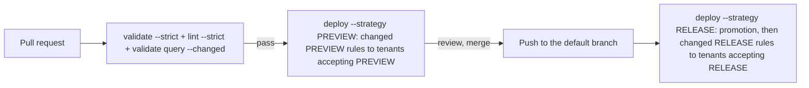

# CI/CD integration

The point of detection-as-code is that a machine enforces quality. A good opentide pipeline **validates every pull request**, **previews** its rules on staging tenants, and **releases** them on merge.



Each job names the strategy it deploys. The pull request job runs `--strategy PREVIEW` and deploys the changed rules whose status maps to `PREVIEW`; the default-branch job runs `--strategy RELEASE`, deploys the changed rules whose status maps to `RELEASE`, and disables or deletes those mapping to `DISABLEMENT` or `DELETION`. Both deploy `UNIVERSAL` rules. A rule in the default `DEVELOPMENT` status is therefore deployed by the pull request job, and a tenant only receives the runs its `strategies` accept. Status names, `STAGING` and `PRODUCTION` included, never decide anything. See [Statuses, strategies and tenants](../concepts/statuses-and-strategies.md).

## Scaffold with setup

The fastest start is to let opentide write the pipeline for you:

```bash
opentide setup platforms --sentinel --yes
opentide setup ci github --yes
opentide setup ci gitlab --yes
opentide setup ci azure --python-version 3.12 --yes
```

`setup ci` discovers enabled platforms from `.opentide/configurations/platforms/` — it does not take `--platform` flags (those belong on `setup platforms` or the parent `opentide setup --platform` callback). Generated pipelines install **`opentide==`** the version that generated them (`opentide==0.17.2` from 0.14.1) and set `OPENTIDE_REPO_ROOT` for every job (GitHub workflow `env`, GitLab `variables`, Azure pipeline `variables`). Re-run `opentide setup ci github --yes` (or `gitlab` or `azure`) after you upgrade to pin the new release.

<Callout type="info">
Hand-written examples below pin `pip install 'opentide==0.17.2'` so a pipeline cannot float onto an accidental `0.x.dev…` local build. `opentide setup ci` is the source of truth.
</Callout>

| Flag | Default | Purpose |
|------|---------|---------|
| `--staging` / `--no-staging` | staging on | Include the staging deploy stage |
| `--sharing` / `--no-sharing` | sharing off | On the default branch, after the production deploy, run `opentide share push --changed` on the branch tip |
| `--promotion` / `--no-promotion` | omit (keep the repository's setting) | Whether `opentide deploy` promotes rules; `--no-promotion` writes `[promotion] enabled = false` to `.opentide/configurations/deployment.toml` |
| `--promotion-target` | omit (keep the repository's setting) | Status `deploy` promotes rules to; another status is written to the same `[promotion]` table |
| `--python-version` | `3.12` | CI Python version |
| `--default-branch` | `origin/HEAD`, then the checked-out branch, then `init.defaultBranch`, then `main` | Branch that deploys and receives inflight shards (GitHub, Azure; GitLab uses `$CI_DEFAULT_BRANCH`) |

The one-shot `opentide setup --ci <github|gitlab|azure>` accepts the same flags. On a repository without `origin/HEAD` whose deploying branch is not checked out, pass `--default-branch`; the result warns when the detected branch is only a guess.

`--sharing` is off unless you pass it or tick "Sharing on the default branch" in the wizard. The generated job runs after the production deploy job, checks out the default branch's tip with full history (not the commit that triggered the run), and runs:

```bash
opentide share push --changed
```

The tip holds the production job's `ci: record production deployment [skip ci]` commit, which records the statuses [promotion](#production-write-back) rewrote. `--changed` diffs from where the triggering push's diff starts (the triggering commit's first parent; on GitLab `CI_COMMIT_BEFORE_SHA` when it is set and not all zeros) to that tip, so a rule merged in `STAGING` and promoted to `PRODUCTION` by this run's deploy is shared in this run. With promotion off the write-back holds only deployment state, and when the deploy has nothing to write back the tip is the triggering commit (or a later push); either way the job shares the push's own changes. A tip that already holds a later push also shares that push's changes; its own run shares them again, as an update.

| CI | Share job ordering | Runs when |
|----|--------------------|-----------|
| GitHub | `needs: [generate, deploy_production]`; checkout `ref: <default branch>` | `!cancelled() && needs.generate.result == 'success'`, `github.event_name == 'push'` and the ref is the default branch |
| GitLab | stage `share` after `deploy`; `needs: [generate, deploy_production]`; script fetches `$CI_DEFAULT_BRANCH` and checks out `FETCH_HEAD` | `CI_COMMIT_BRANCH` is `CI_DEFAULT_BRANCH`, the pipeline is not a merge request, `when: always` |
| Azure | stage `Share` after `Deploy`, `dependsOn: [Generate, Deploy]`; `persistCredentials: true`, script fetches the default branch and checks out `FETCH_HEAD` | `not(canceled())`, `dependencies.Generate.result` is `Succeeded`, `Build.SourceBranch` is the default branch and `Build.Reason` is not `PullRequest` |

The share job waits for the deploy but not for its success: a failed deploy still commits what it recorded, and a share it skipped would never come back, because the next push diffs only its own commits. GitLab cannot ask for "generate passed and deploy finished", so its job runs `when: always` and starts with `opentide validate --strict` on the checkout: a broken catalogue fails the job and shares nothing. A share failure does not affect deploy. Setup does not write `.opentide/configurations/sharing.toml`. Through 0.17.2 the share job ran beside the deploy on the triggering commit, so a rule promoted by that deploy was shared only after a later push changed it; regenerate the pipeline with `opentide setup ci <github|gitlab|azure> --yes`, and share rules promoted before then once with `opentide share push --changed --since <commit>` or a `share push` without `--changed`.

`opentide setup ci` writes the gate from the diagram: `opentide validate --strict`, `opentide lint --strict`, and query validation for each supported platform. A generated live job guards only the `$VAR` names in that platform's enabled file under `.opentide/configurations/platforms/` (comments and literal values do not count). If one of those variables is unset the step prints the names and exits 2. The step runs `opentide validate query --platform <platform> --live --changed`: it checks only the rule files the pull request, merge request or push changed, the files the deploy job of the same run reads ([which rules are checked](../../cli/validate.md#which-rules-are-checked)), so the jobs check out full history. Each changed rule whose status maps to `PREVIEW`, `RELEASE` or `UNIVERSAL` is checked on the tenants a deploy sends it to ([which tenants are checked](../../cli/validate.md#which-tenants-are-checked)), so a pull request that edits a rule in `PRODUCTION` status checks it on the tenants accepting `RELEASE` before it merges; rules that map to `INERT`, `DISABLEMENT` or `DELETION` send no query. Through 0.16.1 the step checked every rule in the catalogue on every run; regenerate the pipeline with `opentide setup ci <github|gitlab|azure> --yes`. The CLI also exits 2 when the platform has rules but none reaches a configured tenant, so no query was sent. Exit 0 means queries were sent and passed, no changed rule has a block for the platform, or the default branch has no `.opentide/configurations` or no tenant for the platform yet, so nothing was sent ([tenant configuration on pull requests](#tenant-configuration-on-pull-requests)). Exit 1 is the check's own failure. On GitLab, `generate` needs the object validate job and every query-validation job, so deploy cannot start after a failed `opentide validate query`. Deploy jobs preview with `--dry-run`, then run `opentide deploy --strategy PREVIEW` or `--strategy RELEASE` with `--skip-unconfigured`, so a repository whose `[[tenants]]` block is still commented out exits 0 instead of failing the pipeline. The header lists every credential variable the bundled platform files reference. GitHub deploy jobs map those names from `secrets`. GitLab and Azure read the same names from the project variable store. There is no `OPENTIDE_SECRETS` variable.

On GitLab the file sets `workflow:rules` so that pipelines run for merge requests and for the default branch only. Every job then runs in merge request pipelines, and a push to a branch with an open merge request starts one pipeline, not a branch pipeline beside it. A branch is validated once it has a merge request, as GitHub validates pull requests: a push to a branch with no merge request starts no pipeline, so open a draft merge request to validate work in progress. Through 0.16.1 the file had no `workflow:rules`, and a GitLab job with no `rules` defaults to `except: merge_requests`: the merge request pipeline held only `deploy_staging` and `inflight_shards`, whose `needs: generate` named a job that was not added, so GitLab refused to start it (`'deploy_staging' job needs 'generate' job, but it was not added to the pipeline`) and the staging deploy never ran.

The staging job commits nothing. In CI, a deploy other than `--strategy RELEASE` on a push therefore refuses to create a Defender for Endpoint, SentinelOne or CrowdStrike rule that has no recorded id (`deployment_state_unpersisted`, before any vendor call), because the id would be lost with the runner and the next run would create the rule again. Updates and deletes of rules that already have an id still run. See [Creates outside the production job](../concepts/deployment-state.md#creates-outside-the-production-job).

### Tenant configuration on pull requests

Live query validation and the staging deploy send platform credentials to the tenant URLs in `.opentide/configurations`, and a pull request can change that directory. The step that runs them therefore first deletes `.opentide/configurations`, fetches the default branch, and checks the directory out again from it. The fetch is shallow only when the checkout already is, so the full-history staging checkout stays complete and the deploy can still find the pull request's merge base. On GitLab the jobs fetch `$CI_DEFAULT_BRANCH` and install `git`. On Azure they check out with `persistCredentials: true` so the fetch can authenticate. On GitHub, `opentide validate --strict` and `opentide lint --strict` run before that step, against the pull request's own configuration; GitLab and Azure run them in a separate job that keeps it.

- A tenant `url` or `$VAR` reference that a pull request adds or changes in the repository root's `.opentide/configurations` never receives a credential.
- That pull request's live query validation and staging deploy use the default branch's tenants instead. Pipelines use the new tenant once it is on the default branch. The same holds for every other file in the directory, such as `deployment.toml` and `paths.toml`.
- When the default branch has no `.opentide/configurations` yet, as on the pull request that adds it, the step prints `The default branch has no .opentide/configurations yet, so no tenant is reviewed. Skipped without using platform credentials.` and exits 0 without running the live commands.
- When the default branch's `.opentide/configurations/platforms/<platform>.toml` has no uncommented line that mentions `tenants`, as with the commented-out `[[tenants]]` block `setup` writes, or the file is missing, the live query step for that platform prints `The default branch has no <platform> tenant yet, so no tenant is reviewed. Skipped <platform> live query validation without using platform credentials.` and exits 0 without connecting. The pull request that uncomments a platform's first tenant therefore passes the gate. Its queries are first checked live by the pipeline that runs on the default branch after the merge.
- The staging deploy of a pull request that adds a platform's first tenant reads the default branch's copy too. With `--skip-unconfigured` it exits 0 when no platform with rules to deploy has a tenant yet. When another such platform has one, it fails with `Cannot deploy: <platform> has no tenants configured in …`, as a deploy on the default branch does until the tenant is merged. Commit the first tenant with the platform's scaffold to avoid that.
- The production job restores nothing: it runs on the default branch.

The step restores only the repository root's `.opentide/configurations`. Configuration read from anywhere else in the checkout still comes from the pull request, so this closes that one configuration-file route only. A pull request can also edit the pipeline file itself (`.github/workflows/*.yml`, `.gitlab-ci.yml` or `azure-pipelines.yml`), and that file runs with the same secrets. Scope platform secrets to a protected environment: GitHub environments with required reviewers, GitLab protected variables and environments, or Azure environment approvals. Through 0.15.0 the generated jobs used the pull request's own `.opentide/configurations`. Regenerate existing pipelines with `opentide setup ci <github|gitlab|azure> --yes`.

### Production write-back

The generated production job runs `opentide deploy --strategy RELEASE`. A changed rule whose status maps to `DISABLEMENT` (default `DISABLED`) or `DELETION` (default `REMOVED`) is therefore disabled or deleted on the tenants accepting `RELEASE`, as the [deployment spec](/docs/specifications/specs/deployment/) defines; `--drop-deprecated` turns that off.

A production deploy changes the checkout: promotion rewrites the `status` of the rules it deploys, and Defender, SentinelOne and CrowdStrike record the vendor id each create returns, in `.opentide/states/deployment/`. The job reads the newest deployment state before it deploys and commits those changes to the default branch afterwards.

Before the dry-run, the job fetches the default branch and replaces `.opentide/states/deployment/` in the checkout with the tip's copy (removing the folder first, so a shard the tip deleted stays deleted, and removing it entirely when the tip has none). The job checks out the commit that triggered it, and a write-back from an earlier run may have landed since: without this, a merge made before that write-back would not see the ids it recorded, and would create those rules a second time. The tip descends from the triggering commit, so it already holds that commit's state. The overlay is also recorded as a local commit (never pushed), so the write-back commit holds only this run's changes.

The write-back:

- Runs whenever the real deploy started, including when the deploy failed part way, was cancelled, or hit the job timeout. If the deploy created three Defender rules and failed on the fourth, the three ids are committed; losing them would make the next run create those rules again. A failed deploy still fails the job. It does not run when the dry-run failed, because the real deploy then never started.
- Stages everything under `.opentide/states/deployment/` first, unconditionally.
- Then runs `opentide validate --strict --file …` on exactly the rule files the deploy modified (tracked files in the rules folder, read from the workspace configuration when `setup ci` runs, `objects/rules` by default). The file list is read NUL-delimited (`git diff -z`), so a name with a quote, backslash, tab or newline reaches `--file` as itself, and `opentide validate` fails when any `--file` matches no object. When validation passes the rule files are staged too. When it fails the log says `opentide validate --strict failed on the deployed rule files: committing the deployment state only, not the rule files.`, the state is still committed and pushed, and the step then fails. Nothing else in the checkout is committed.
- When nothing changed it prints `No deployment write-backs to commit` and commits nothing.
- The commit message is `ci: record production deployment [skip ci]`, so it starts no new pipeline.
- A push rejected because the branch moved is rebased onto the new tip and retried, up to five attempts, the same loop the inflight job uses.
- A rebase that conflicts (a concurrent merge edited a promoted rule, or the same shard) does not lose the state. The job drops the rule write-back, replays this run's deployment-state changes per platform and tenant onto the tip's shards, pushes that, and then fails so the dropped rule write-back is visible. When both runs changed the same binding, this run's id is kept and `deployment_state_conflict` prints both ids so the duplicate remote rule can be removed.
- Once the state commit exists, any failure that leaves it off the default branch (every push attempt rejected, a fetch that fails, a replay that fails) prints the deployment-state diff to the log and pushes the commit to `refs/opentide/deployment-state/<commit>` before the job fails. Record those ids before the next deploy. The side-ref push is best effort: a CI identity that cannot push at all still leaves the diff in the log.
- `.opentide/states/deployment/` must be committed, not ignored. If `.gitignore` still excludes `.opentide/states/`, staging the shards fails and the job fails rather than discarding vendor ids; ignore only `.opentide/states/sharing.jsonl`.

The write-back script needs bash (`read -d ''`). GitHub `run:` steps and Azure `script:` steps use bash on Linux, and GitLab uses it when the image has it, as the default `python:<version>-slim` image does.

Production deploys are queued where the provider can queue without dropping runs:

- **GitHub**: the job has **no** `concurrency` group. GitHub keeps only one run pending per group and cancels an older *pending* run when a newer one queues; the production job deploys only its own commit's diff, so a cancelled run's rules would silently never deploy. Overlapping runs are tolerated instead: each starts from the default branch's newest deployment state, and if two overlapping runs both create the same new rule, the write-back reports `deployment_state_conflict` with both ids and fails the job, so the duplicate is removed by hand.
- **GitLab**: the job has `resource_group: opentide-production`, which queues every production job.
- **Azure**: a YAML pipeline cannot serialise a job on its own. The pipeline sets `lockBehavior: sequential`; add an **Exclusive lock** check to a protected resource the Deploy stage uses (for example an environment or the agent pool), and runs then queue in order. Without that check, Azure production deploys can overlap.

The job runs only on the default branch. On GitHub the deploy is a step with `id: deploy` and the write-back step has `if: ${{ always() && steps.deploy.outcome != 'skipped' }}`; `always()` is what lets a step run after a cancellation. The job carries `permissions: contents: write`. On GitLab, whose script stops at the first failing line, the deploy and the write-back share one script block that runs the write-back after a failed deploy and then exits with the deploy's status. A GitLab job cancelled during the deploy runs the same write-back from `after_script`. GitLab does not run `after_script` for a job that hits its timeout, unless the runner's `RUNNER_SCRIPT_TIMEOUT` is set below the job timeout; a timed-out GitLab deploy therefore loses the ids it recorded, apart from the `external_id_recorded` lines in its log. Keep the GitLab job timeout well above the deploy's run time. On Azure the deploy step sets `OPENTIDE_DEPLOY_STARTED` just before the real deploy, the write-back step has `condition: and(always(), eq(variables['OPENTIDE_DEPLOY_STARTED'], 'true'))`, and the checkout uses `persistCredentials: true`, so the build service needs **Contribute** on the repository. GitLab installs `git` in the job and pushes with `CI_JOB_TOKEN`, which needs the project's job-token push access, as for the inflight job. Branch protection on the default branch must let that CI identity push.

Every new vendor id is also logged as `external_id_recorded` at warning level, so the CI log carries it whatever happens to the runner.

Through 0.14.2 the production job dropped `DISABLED` and `REMOVED` rules before the `PRODUCTION` allow-list was consulted, and discarded the write-backs, so promoted statuses never landed and every later deploy of a Defender, SentinelOne or CrowdStrike rule created a duplicate remote rule. Regenerate existing pipelines with `opentide setup ci <github|gitlab|azure> --yes`.

An Azure pipeline from **0.8.0** sets `pool.vmImage` to `ubuntu-latest` and triggers on every branch, so a topic-branch push still validates. Azure Repos Git ignores `pr:`. Add a build validation policy on the default branch so a pull request sets `Build.Reason` to `PullRequest`. Staging deploy stays gated on that reason. The pipeline file cannot create the policy.

### Behind a proxy or a private CA

The generated file sets no proxy and no certificate: both belong to the runner's network. Set them as GitLab CI/CD variables (project or group) or Azure pipeline variables, which every job receives as environment variables, or in the runner's own environment (a self-hosted GitHub runner reads its `.env` file). Nothing in the generated file needs editing.

| Variable | Read by |
|----------|---------|
| `HTTP_PROXY`, `HTTPS_PROXY` | `pip` and opentide (either spelling) |
| `http_proxy`, `https_proxy` | `apt-get`, which installs `git` in the GitLab jobs, and `git` itself (lowercase only for plain HTTP) |
| `NO_PROXY`, `no_proxy` | Every tool above: hosts reached directly |
| `OPENTIDE_PROXY` | opentide only, the same as `opentide --proxy`: platform and lookup calls, not `pip` or `git` |

Set both spellings to the same values. A proxy defined only in capitals leaves `apt-get` without one, and the GitLab jobs that install `git` fail before opentide runs.

**A cloud tenant through the proxy and an internal one without it.** List the internal tenant's host in `NO_PROXY` and `no_proxy`, for example `NO_PROXY=splunk.internal.example,.internal.example`. opentide's platform clients honour it, so one deploy job reaches Sentinel through the proxy and Splunk directly. Sent through the proxy, a request for an internal tenant gets the proxy's HTML error page back where the Splunk client expects XML. There is no need to split the deploy per platform, and the generated file does not: the production job is the only one that commits deployment state, once per run ([production write-back](#production-write-back)).

To send only opentide's platform calls through the proxy while `pip` and `git` go direct, set `OPENTIDE_PROXY` instead of the four proxy variables. `NO_PROXY` still applies to it.

**A private certificate authority.** Point each tool at the CA bundle rather than turning verification off. In GitLab, a variable of type *File* holds the bundle and is exported as the path to it:

| Variable | Read by |
|----------|---------|
| `GIT_SSL_CAINFO` | `git` fetch and push in the generated jobs |
| `PIP_CERT` | `pip install` |
| `REQUESTS_CA_BUNDLE`, `SSL_CERT_FILE` | opentide's platform clients and lookups |

On GitLab, `CI_SERVER_TLS_CA_FILE` holds the CA the runner trusts for the GitLab server when the runner sets `tls-ca-file`, so `GIT_SSL_CAINFO: $CI_SERVER_TLS_CA_FILE` reuses it. `GIT_SSL_NO_VERIFY` also gets `git` past a private CA, but it turns certificate checks off for the fetch and for the push that carries the job token, so anyone between the runner and GitLab can read that token. The generated file never sets it.

## Stage 1 — validate every pull request

This is the non-negotiable gate. Object validation needs no secrets. The live query check sends each changed rule's queries to its tenants, so it needs the platform credentials, and `--changed` diffs from the pull request's merge base, so the checkout needs full history. The sketches below are minimal: `opentide setup ci` is the source of truth. Among other things, it replaces `.opentide/configurations` with the default branch's copy before any step that uses a credential ([tenant configuration on pull requests](#tenant-configuration-on-pull-requests)), which these sketches do not.

```yaml
# .github/workflows/validate.yml
name: validate
on: pull_request
jobs:
  validate:
    runs-on: ubuntu-latest
    env:
      OPENTIDE_REPO_ROOT: ${{ github.workspace }}
      AZURE_TENANT_ID: ${{ secrets.AZURE_TENANT_ID }}
      AZURE_SUBSCRIPTION_ID: ${{ secrets.AZURE_SUBSCRIPTION_ID }}
      AZURE_CLIENT_ID: ${{ secrets.AZURE_CLIENT_ID }}
      AZURE_CLIENT_SECRET: ${{ secrets.AZURE_CLIENT_SECRET }}
      AZURE_WORKSPACE_ID: ${{ secrets.AZURE_WORKSPACE_ID }}
    steps:
      - uses: actions/checkout@v4
        with: { fetch-depth: 0 }
      - uses: actions/setup-python@v5
        with: { python-version: "3.12" }
      - run: pip install 'opentide==0.17.2'
      - run: opentide validate --strict
      - run: opentide validate query --platform sentinel --live --changed
```

## Stage 2 — preview on the pull request (`--strategy PREVIEW`)

`--strategy PREVIEW` deploys the pull request's changed rules whose status maps to `PREVIEW` (the default `DEVELOPMENT`, `IMPROVING`, `STAGING` and `ACCEPTANCE`) or `UNIVERSAL`, to the tenants whose `strategies` accept `PREVIEW`. In a pull request pipeline it reads the request's diff from its merge base, so the job checks out full history. Add the job to the same workflow:

```yaml
  deploy-staging:
    needs: validate
    if: github.base_ref == 'main'      # only pull requests into the default branch
    runs-on: ubuntu-latest
    environment: staging
    env:
      OPENTIDE_REPO_ROOT: ${{ github.workspace }}
      AZURE_TENANT_ID: ${{ secrets.AZURE_TENANT_ID }}
      AZURE_SUBSCRIPTION_ID: ${{ secrets.AZURE_SUBSCRIPTION_ID }}
      AZURE_CLIENT_ID: ${{ secrets.AZURE_CLIENT_ID }}
      AZURE_CLIENT_SECRET: ${{ secrets.AZURE_CLIENT_SECRET }}
      AZURE_WORKSPACE_ID: ${{ secrets.AZURE_WORKSPACE_ID }}
    steps:
      - uses: actions/checkout@v4
        with: { fetch-depth: 0 }
      - uses: actions/setup-python@v5
        with: { python-version: "3.12" }
      - run: pip install 'opentide==0.17.2'
      - run: opentide deploy --strategy PREVIEW --dry-run   # preview in logs
      - run: opentide deploy --strategy PREVIEW
```

A rule whose status maps to `RELEASE` is not deployed here: it is released on merge.

## Stage 3 — release on merge (`--strategy RELEASE`)

`--strategy RELEASE` on a push to the default branch reads the pushed commit's diff. When promotion is enabled (the default), it first rewrites the status of each changed rule whose status maps to `INERT`, `PREVIEW` or `UNIVERSAL` to `promotion_target` (`PRODUCTION`), so merging a rule releases it. It then deploys the rules mapping to `RELEASE` or `UNIVERSAL` to the tenants whose `strategies` accept `RELEASE`, and disables or deletes those mapping to `DISABLEMENT` or `DELETION` there. Gate it behind a protected environment.

```yaml
# .github/workflows/deploy.yml
name: deploy
on:
  push:
    branches: [main]
jobs:
  deploy-production:
    runs-on: ubuntu-latest
    environment: production          # require reviewers on this environment
    env:
      OPENTIDE_REPO_ROOT: ${{ github.workspace }}
      AZURE_TENANT_ID: ${{ secrets.AZURE_TENANT_ID }}
      AZURE_SUBSCRIPTION_ID: ${{ secrets.AZURE_SUBSCRIPTION_ID }}
      AZURE_CLIENT_ID: ${{ secrets.AZURE_CLIENT_ID }}
      AZURE_CLIENT_SECRET: ${{ secrets.AZURE_CLIENT_SECRET }}
      AZURE_WORKSPACE_ID: ${{ secrets.AZURE_WORKSPACE_ID }}
    steps:
      - uses: actions/checkout@v4
        with: { fetch-depth: 0 }
      - uses: actions/setup-python@v5
        with: { python-version: "3.12" }
      - run: pip install 'opentide==0.17.2'
      - run: opentide deploy --strategy RELEASE --dry-run
      - run: opentide deploy --strategy RELEASE
```

Promotion rewrites rule files, and Defender for Endpoint, SentinelOne and CrowdStrike record each new rule's id under `.opentide/states/deployment/`. This sketch leaves both on the runner; the generated production job commits them back to the default branch ([production write-back](#production-write-back)).

## Secrets

Never commit platform credentials. Inject them as CI secrets and reference them from your platform TOML with `${VAR}` — see [Configuration → credentials](../configuration.md#credentials).

| Where | How |
|-------|-----|
| **GitHub** | Repository/environment secrets → `env:` or `${{ secrets.X }}` |
| **GitLab** | CI/CD variables (masked, protected) → available as env vars |
| **Azure** | Pipeline variables / variable groups (secret) → env vars |

Scope production secrets to a protected environment so PR builds from forks cannot read them.

## GitLab CI

```yaml
# .gitlab-ci.yml
workflow:
  rules:
    - if: $CI_PIPELINE_SOURCE == "merge_request_event"
    - if: $CI_COMMIT_BRANCH == $CI_DEFAULT_BRANCH

stages: [validate, deploy]

variables:
  OPENTIDE_REPO_ROOT: $CI_PROJECT_DIR
  GIT_DEPTH: "0"

default:
  image: python:3.12
  before_script:
    - pip install 'opentide==0.17.2'

validate:
  stage: validate
  script:
    - opentide validate --strict
    - opentide validate query --platform sentinel --live --changed

deploy-staging:
  stage: deploy
  rules:
    - if: $CI_PIPELINE_SOURCE == "merge_request_event" && $CI_MERGE_REQUEST_TARGET_BRANCH_NAME == $CI_DEFAULT_BRANCH
  script:
    - opentide deploy --strategy PREVIEW

deploy-production:
  stage: deploy
  rules:
    - if: $CI_COMMIT_BRANCH == $CI_DEFAULT_BRANCH
  script:
    - opentide deploy --strategy RELEASE
```

Without `workflow:rules`, a GitLab job with no `rules` (here `validate`) is left out of merge request pipelines.

## Azure Pipelines

```yaml
# azure-pipelines.yml
trigger: [main]
pool: { vmImage: ubuntu-latest }
variables:
  OPENTIDE_REPO_ROOT: $(Build.SourcesDirectory)
steps:
  - checkout: self
    fetchDepth: 0
  - task: UsePythonVersion@0
    inputs: { versionSpec: '3.12' }
  - script: pip install 'opentide==0.17.2'
  - script: opentide validate --strict
  - script: opentide validate query --platform sentinel --live --changed
  - script: opentide deploy --strategy RELEASE
    # A custom condition replaces the default succeeded(): keep it, or a failed check still deploys.
    condition: and(succeeded(), eq(variables['Build.SourceBranch'], 'refs/heads/main'))
```

## Annotations, summaries and reports

In a GitHub Actions, GitLab CI or Azure Pipelines job (`GITHUB_ACTIONS`, `GITLAB_CI` or `TF_BUILD` is set), opentide adds to its usual output. Nothing has to be configured; `--json` turns all of it off, because stdout then holds the JSON document.

| Provider | Each finding of `validate` and `lint` | Job summary |
|----------|----------------------------------------|-------------|
| GitHub Actions | A workflow command on stdout, which GitHub shows on the line of the pull request's diff: `::error file=objects/rules/sentinel-kql-rule.yaml,line=8,endLine=8,col=8,endColumn=13,title=vocab_unknown::Value 'clearr' is not a valid 'tlp::1.0' vocabulary entry%0Ahelp: did you mean 'clear'?` | Markdown appended to `$GITHUB_STEP_SUMMARY` |
| GitLab CI | None inline: GitLab shows the Code Quality report in the merge request widget on every tier, and on the lines of the diff on GitLab Ultimate | Markdown appended to `opentide-reports/summary.md` in the checkout, kept as an artifact |
| Azure Pipelines | `##vso[task.logissue type=error;sourcepath=…;linenumber=8;columnnumber=8;code=vocab_unknown;]…` (notes have no Azure level and are not sent) | A Markdown file attached with `##vso[task.uploadsummary]` |

On GitHub, which shows 10 annotations of each level per step, opentide writes the errors first, then the warnings, then the notices, 10 of each, and one notice counting the rest; the job summary and code scanning have them all.

The summary of `validate` and `lint` is the outcome line and a table of findings (severity, code linked to its [explanation](../../cli/diagnostics.md), location, message), at most 100 rows. `deploy` adds its plan: the strategies, the rules per platform and tenant, and the rule names. `validate query` adds the queries sent per tenant. A `deploy` that found no rule to deploy adds a run warning on GitHub and Azure. Paths are relative to the checkout (`GITHUB_WORKSPACE`, `CI_PROJECT_DIR`, `BUILD_SOURCESDIRECTORY`), so they stay right when the workspace is a folder of the repository.

`validate` and `lint` also write their findings as a report file for the provider's code-quality view:

```bash
opentide validate --strict --format sarif --output opentide-reports/validate.sarif
opentide lint --strict --format codequality --output opentide-reports/lint.codequality.json
```

`--format sarif` is SARIF 2.1.0 for GitHub code scanning; each code is a rule whose help is its `opentide explain` page, and a vocabulary typo carries its fix. `--format codequality` is the Code Climate JSON GitLab reads from `artifacts:reports:codequality`. The report is written whatever the outcome, an empty one included, so a fixed finding closes its alert. Findings that name no file (two objects with the same id, for example) are left out of both formats, which need one; the log and the summary still show them. Without `--output` the report is the whole of stdout, with no code frames or annotations. With `--json`, `--output` is required.

`opentide setup ci` writes these into the validate job:

| Provider | Validate job |
|----------|--------------|
| GitHub Actions | `--format sarif` reports, uploaded as the `opentide-reports` artifact, and on a public repository sent to code scanning by a `code_scanning` job that needs `validate`, downloads the artifact and runs `github/codeql-action/upload-sarif@v4`. That job holds only `security-events: write`, so the token that writes alerts never sits next to the platform secrets. The alerts are in the categories `opentide/validate/` and `opentide/lint/` (each SARIF run's `automationDetails.id`); a failed upload never fails the run. Code scanning on a private repository needs GitHub Advanced Security: once it is on, remove `!github.event.repository.private` from the job's `if` |
| GitLab CI | `--format codequality` reports under `artifacts:reports:codequality`, and `opentide-reports/` exposed in the merge request as "opentide reports". The query, staging and production jobs keep `opentide-reports/summary.md` |
| Azure Pipelines | `--format sarif` reports published as the `CodeAnalysisLogs` artifact, which the SARIF SAST Scans Tab extension reads |

Regenerate an existing pipeline with `opentide setup ci <github|gitlab|azure> --yes` to get them.

## JSON output for gates

Every command accepts `--json` and writes exactly one JSON document to stdout — successes carry `"ok": true`, failures carry `"ok": false` plus `status`, `message`, and the full report. Diagnostics go to stderr. Gate on the process exit code, the `ok`/`status` fields, or both. Under `--json` opentide writes no annotation and no job summary.

```bash
opentide --json validate --strict
```

See [CLI → JSON output](../../cli/index.md) and [exit codes](../../cli/exit-codes.md).

## Documentation in CI

```bash
opentide generate docs --flavor github
```

The flavor adapts to where the docs are read: `--flavor` if given, else the CI platform running the job (`GITHUB_ACTIONS` → `github`, `GITLAB_CI` → `gitlab`, `TF_BUILD` → `azure_devops`), else the host of the repository's `origin` remote (GitHub, GitLab or Azure DevOps, self-hosted included when the host name says so), else `[flavor] default` in `documentation.toml`, plain CommonMark (`generic`) out of the box. Another CI (Jenkins, CircleCI) no longer selects GitLab. See [`generate docs`](../../cli/generate.md).

## Migrating from submodule CI

Remove `submodules: recursive` from checkout and install from PyPI instead. Replace legacy Orchestration scripts:

| Legacy script | CLI replacement |
|---------------|-----------------|
| `Orchestration/validate.py` | `opentide validate` |
| `Orchestration/generate.py` | `opentide generate` |
| `Orchestration/deploy.py` | `opentide deploy` |
| `Orchestration/document.py` | `opentide generate docs` |

See the [migration guide](../migration/index.md).
