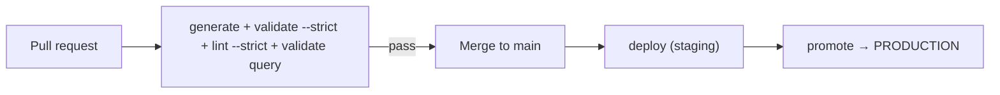

# CI/CD integration

The point of detection-as-code is that a machine enforces quality. A good opentide pipeline **validates every pull request** and **deploys on merge**, promoting to production as a controlled step.



## Scaffold with setup

The fastest start is to let opentide write the pipeline for you:

```bash
opentide setup platforms --sentinel --yes
opentide setup ci github --yes
opentide setup ci gitlab --yes
opentide setup ci azure --python-version 3.12 --yes
```

`setup ci` discovers enabled platforms from `.opentide/configurations/platforms/` — it does not take `--platform` flags (those belong on `setup platforms` or the parent `opentide setup --platform` callback). Generated pipelines install **`opentide==`** the version that generated them (`opentide==0.16.1` from 0.14.1) and set `OPENTIDE_REPO_ROOT` for every job (GitHub workflow `env`, GitLab `variables`, Azure pipeline `variables`). Re-run `opentide setup ci github --yes` (or `gitlab` or `azure`) after you upgrade to pin the new release.

<Callout type="info">
Hand-written examples below pin `pip install 'opentide==0.16.1'` so a pipeline cannot float onto an accidental `0.x.dev…` local build. `opentide setup ci` is the source of truth.
</Callout>

| Flag | Default | Purpose |
|------|---------|---------|
| `--staging` / `--no-staging` | staging on | Include the staging deploy stage |
| `--sharing` / `--no-sharing` | sharing off | On the default branch, after generate, run `opentide share push --changed` |
| `--promotion` / `--no-promotion` | omit (keep the repository's setting) | Whether `opentide deploy` promotes rules; `--no-promotion` writes `[promotion] enabled = false` to `.opentide/configurations/deployment.toml` |
| `--promotion-target` | omit (keep the repository's setting) | Status `deploy` promotes rules to; another status is written to the same `[promotion]` table |
| `--python-version` | `3.12` | CI Python version |
| `--default-branch` | `origin/HEAD`, then the checked-out branch, then `init.defaultBranch`, then `main` | Branch that deploys and receives inflight shards (GitHub, Azure; GitLab uses `$CI_DEFAULT_BRANCH`) |

The one-shot `opentide setup --ci <github|gitlab|azure>` accepts the same flags. On a repository without `origin/HEAD` whose deploying branch is not checked out, pass `--default-branch`; the result warns when the detected branch is only a guess.

`--sharing` is off unless you pass it or tick "Sharing on the default branch" in the wizard. The generated job checks out full history and runs only:

```bash
opentide share push --changed
```

GitHub runs that job when `github.event_name == 'push'` and the ref is the default branch. GitLab runs it when `CI_COMMIT_BRANCH` is `CI_DEFAULT_BRANCH` and the pipeline is not a merge request. Azure runs it when `Build.SourceBranch` is the default branch and `Build.Reason` is not `PullRequest`. The job needs generate. Deploy still needs only generate, so a share failure does not block deploy and deploy does not block share. Setup does not write `.opentide/configurations/sharing.toml`.

`opentide setup ci` writes the gate from the diagram: `opentide validate --strict`, `opentide lint --strict`, and query validation for each supported platform. A generated live job guards only the `$VAR` names in that platform's enabled file under `.opentide/configurations/platforms/` (comments and literal values do not count). If one of those variables is unset the step prints the names and exits 2. The step runs `opentide validate query --platform <platform> --live --changed`: it checks only the rule files the pull request, merge request or push changed, the files the deploy job of the same run reads ([which rules are checked](../../cli/validate.md#which-rules-are-checked)), so the jobs check out full history. It passes no `--plan`, so each changed rule is checked on every tenant it can reach, `STAGING` and `PRODUCTION` alike, whatever its status ([which tenants are checked](../../cli/validate.md#which-tenants-are-checked)). Through 0.16.1 the step checked every rule in the catalogue on every run; regenerate the pipeline with `opentide setup ci <github|gitlab|azure> --yes`. The CLI also exits 2 when the platform has rules but none reaches a configured tenant, so no query was sent. Exit 0 means queries were sent and passed, no changed rule has a block for the platform, or the default branch has no `.opentide/configurations` or no tenant for the platform yet, so nothing was sent ([tenant configuration on pull requests](#tenant-configuration-on-pull-requests)). Exit 1 is the check's own failure. On GitLab, `generate` needs the object validate job and every query-validation job, so deploy cannot start after a failed `opentide validate query`. Deploy jobs preview with `--dry-run`, then run `opentide deploy --plan STAGING` or `PRODUCTION` with `--skip-unconfigured`, so a repository whose `[[tenants]]` block is still commented out exits 0 instead of failing the pipeline. The header lists every credential variable the bundled platform files reference. GitHub deploy jobs map those names from `secrets`. GitLab and Azure read the same names from the project variable store. There is no `OPENTIDE_SECRETS` variable.

The staging job commits nothing. In CI, a deploy whose plan is not `PRODUCTION` therefore refuses to create a Defender for Endpoint, SentinelOne or CrowdStrike rule that has no recorded id (`deployment_state_unpersisted`, before any vendor call), because the id would be lost with the runner and the next run would create the rule again. Updates and deletes of rules that already have an id still run. See [Creates outside the production job](../concepts/deployment-state.md#creates-outside-the-production-job).

### Tenant configuration on pull requests

Live query validation and the staging deploy send platform credentials to the tenant URLs in `.opentide/configurations`, and a pull request can change that directory. The step that runs them therefore first deletes `.opentide/configurations`, fetches the default branch, and checks the directory out again from it. The fetch is shallow only when the checkout already is, so the full-history staging checkout stays complete and the deploy can still find the pull request's merge base. On GitLab the jobs fetch `$CI_DEFAULT_BRANCH` and install `git`. On Azure they check out with `persistCredentials: true` so the fetch can authenticate. On GitHub, `opentide validate --strict` and `opentide lint --strict` run before that step, against the pull request's own configuration; GitLab and Azure run them in a separate job that keeps it.

- A tenant `url` or `$VAR` reference that a pull request adds or changes in the repository root's `.opentide/configurations` never receives a credential.
- That pull request's live query validation and staging deploy use the default branch's tenants instead. Pipelines use the new tenant once it is on the default branch. The same holds for every other file in the directory, such as `deployment.toml` and `paths.toml`.
- When the default branch has no `.opentide/configurations` yet, as on the pull request that adds it, the step prints `The default branch has no .opentide/configurations yet, so no tenant is reviewed. Skipped without using platform credentials.` and exits 0 without running the live commands.
- When the default branch's `.opentide/configurations/platforms/<platform>.toml` has no uncommented line that mentions `tenants`, as with the commented-out `[[tenants]]` block `setup` writes, or the file is missing, the live query step for that platform prints `The default branch has no <platform> tenant yet, so no tenant is reviewed. Skipped <platform> live query validation without using platform credentials.` and exits 0 without connecting. The pull request that uncomments a platform's first tenant therefore passes the gate. Its queries are first checked live by the pipeline that runs on the default branch after the merge.
- The staging deploy of a pull request that adds a platform's first tenant reads the default branch's copy too. With `--skip-unconfigured` it exits 0 when no platform in the plan has a tenant yet. When another platform in the plan has one, it fails with `Cannot deploy: <platform> has no tenants configured in …`, as a deploy on the default branch does until the tenant is merged. Commit the first tenant with the platform's scaffold to avoid that.
- The production job restores nothing: it runs on the default branch.

The step restores only the repository root's `.opentide/configurations`. Configuration read from anywhere else in the checkout still comes from the pull request, so this closes that one configuration-file route only. A pull request can also edit the pipeline file itself (`.github/workflows/*.yml`, `.gitlab-ci.yml` or `azure-pipelines.yml`), and that file runs with the same secrets. Scope platform secrets to a protected environment: GitHub environments with required reviewers, GitLab protected variables and environments, or Azure environment approvals. Through 0.15.0 the generated jobs used the pull request's own `.opentide/configurations`. Regenerate existing pipelines with `opentide setup ci <github|gitlab|azure> --yes`.

### Production write-back

The generated production job runs `opentide deploy --plan PRODUCTION --keep-deprecated`. A rule whose status maps to `DISABLEMENT` (bundled `DISABLED`) or `DELETION` (bundled `REMOVED`) is therefore disabled or deleted on the platform, as the [deployment spec](/docs/specifications/specs/deployment/) defines; `--keep-deprecated` is also the CLI default for the `PRODUCTION` plan, and `--drop-deprecated` turns it off.

A production deploy changes the checkout: promotion rewrites the `status` of the rules it deploys, and Defender, SentinelOne and CrowdStrike record the vendor id each create returns, in `.opentide/states/deployment/`. The job reads the newest deployment state before it deploys and commits those changes to the default branch afterwards.

Before the dry-run, the job fetches the default branch and replaces `.opentide/states/deployment/` in the checkout with the tip's copy (removing the folder first, so a shard the tip deleted stays deleted, and removing it entirely when the tip has none). The job checks out the commit that triggered it, and a write-back from an earlier run may have landed since: without this, a merge made before that write-back would not see the ids it recorded, and would create those rules a second time. The tip descends from the triggering commit, so it already holds that commit's state. The overlay is also recorded as a local commit (never pushed), so the write-back commit holds only this run's changes.

The write-back:

- Runs whenever the real deploy started, including when the deploy failed part way, was cancelled, or hit the job timeout. If the deploy created three Defender rules and failed on the fourth, the three ids are committed; losing them would make the next run create those rules again. A failed deploy still fails the job. It does not run when the dry-run failed, because the real deploy then never started.
- Stages everything under `.opentide/states/deployment/` first, unconditionally.
- Then runs `opentide validate --strict --file …` on exactly the rule files the deploy modified (tracked files in the rules folder, read from the workspace configuration when `setup ci` runs, `objects/rules` by default). The file list is read NUL-delimited (`git diff -z`), so a name with a quote, backslash, tab or newline reaches `--file` as itself, and `opentide validate` fails when any `--file` matches no object. When validation passes the rule files are staged too. When it fails the log says `opentide validate --strict failed on the deployed rule files: committing the deployment state only, not the rule files.`, the state is still committed and pushed, and the step then fails. Nothing else in the checkout is committed.
- When nothing changed it prints `No deployment write-backs to commit` and commits nothing.
- The commit message is `ci: record production deployment [skip ci]`, so it starts no new pipeline.
- A push rejected because the branch moved is rebased onto the new tip and retried, up to five attempts, the same loop the inflight job uses.
- A rebase that conflicts (a concurrent merge edited a promoted rule, or the same shard) does not lose the state. The job drops the rule write-back, replays this run's deployment-state changes per platform and tenant onto the tip's shards, pushes that, and then fails so the dropped rule write-back is visible. When both runs changed the same binding, this run's id is kept and `deployment_state_conflict` prints both ids so the duplicate remote rule can be removed.
- Once the state commit exists, any failure that leaves it off the default branch (every push attempt rejected, a fetch that fails, a replay that fails) prints the deployment-state diff to the log and pushes the commit to `refs/opentide/deployment-state/<commit>` before the job fails. Record those ids before the next deploy. The side-ref push is best effort: a CI identity that cannot push at all still leaves the diff in the log.
- `.opentide/states/deployment/` must be committed, not ignored. If `.gitignore` still excludes `.opentide/states/`, staging the shards fails and the job fails rather than discarding vendor ids; ignore only `.opentide/states/sharing.jsonl`.

The write-back script needs bash (`read -d ''`). GitHub `run:` steps and Azure `script:` steps use bash on Linux, and GitLab uses it when the image has it, as the default `python:<version>-slim` image does.

Production deploys are queued where the provider can queue without dropping runs:

- **GitHub**: the job has **no** `concurrency` group. GitHub keeps only one run pending per group and cancels an older *pending* run when a newer one queues; the production plan deploys only its own commit's diff, so a cancelled run's rules would silently never deploy. Overlapping runs are tolerated instead: each starts from the default branch's newest deployment state, and if two overlapping runs both create the same new rule, the write-back reports `deployment_state_conflict` with both ids and fails the job, so the duplicate is removed by hand.
- **GitLab**: the job has `resource_group: opentide-production`, which queues every production job.
- **Azure**: a YAML pipeline cannot serialise a job on its own. The pipeline sets `lockBehavior: sequential`; add an **Exclusive lock** check to a protected resource the Deploy stage uses (for example an environment or the agent pool), and runs then queue in order. Without that check, Azure production deploys can overlap.

The job runs only on the default branch. On GitHub the deploy is a step with `id: deploy` and the write-back step has `if: ${{ always() && steps.deploy.outcome != 'skipped' }}`; `always()` is what lets a step run after a cancellation. The job carries `permissions: contents: write`. On GitLab, whose script stops at the first failing line, the deploy and the write-back share one script block that runs the write-back after a failed deploy and then exits with the deploy's status. A GitLab job cancelled during the deploy runs the same write-back from `after_script`. GitLab does not run `after_script` for a job that hits its timeout, unless the runner's `RUNNER_SCRIPT_TIMEOUT` is set below the job timeout; a timed-out GitLab deploy therefore loses the ids it recorded, apart from the `external_id_recorded` lines in its log. Keep the GitLab job timeout well above the deploy's run time. On Azure the deploy step sets `OPENTIDE_DEPLOY_STARTED` just before the real deploy, the write-back step has `condition: and(always(), eq(variables['OPENTIDE_DEPLOY_STARTED'], 'true'))`, and the checkout uses `persistCredentials: true`, so the build service needs **Contribute** on the repository. GitLab installs `git` in the job and pushes with `CI_JOB_TOKEN`, which needs the project's job-token push access, as for the inflight job. Branch protection on the default branch must let that CI identity push.

Every new vendor id is also logged as `external_id_recorded` at warning level, so the CI log carries it whatever happens to the runner.

Through 0.14.2 the production job dropped `DISABLED` and `REMOVED` rules before the `PRODUCTION` allow-list was consulted, and discarded the write-backs, so promoted statuses never landed and every later deploy of a Defender, SentinelOne or CrowdStrike rule created a duplicate remote rule. Regenerate existing pipelines with `opentide setup ci <github|gitlab|azure> --yes`.

An Azure pipeline from **0.8.0** sets `pool.vmImage` to `ubuntu-latest` and triggers on every branch, so a topic-branch push still validates. Azure Repos Git ignores `pr:`. Add a build validation policy on the default branch so a pull request sets `Build.Reason` to `PullRequest`. Staging deploy stays gated on that reason. The pipeline file cannot create the policy.

## Stage 1 — validate every PR

This is the non-negotiable gate. It needs no secrets (query validation checks syntax, not connectivity).

```yaml
# .github/workflows/validate.yml
name: validate
on: pull_request
jobs:
  validate:
    runs-on: ubuntu-latest
    env:
      OPENTIDE_REPO_ROOT: ${{ github.workspace }}
    steps:
      - uses: actions/checkout@v4
      - uses: actions/setup-python@v5
        with: { python-version: "3.12" }
      - run: pip install 'opentide==0.16.1'
      - run: opentide generate
      - run: opentide validate --strict
      - run: opentide validate query --platform sentinel --live
```

## Stage 2 — deploy on merge (staging)

Runs on push to `main`, deploying rules in their current status. This is where platform **secrets** are needed.

```yaml
# .github/workflows/deploy.yml
name: deploy
on:
  push:
    branches: [main]
jobs:
  deploy-staging:
    runs-on: ubuntu-latest
    environment: staging
    env:
      OPENTIDE_REPO_ROOT: ${{ github.workspace }}
      DEPLOYMENT_PLAN: staging
      AZURE_TENANT_ID: ${{ secrets.AZURE_TENANT_ID }}
      AZURE_CLIENT_ID: ${{ secrets.AZURE_CLIENT_ID }}
      AZURE_CLIENT_SECRET: ${{ secrets.AZURE_CLIENT_SECRET }}
      AZURE_WORKSPACE_ID: ${{ secrets.AZURE_WORKSPACE_ID }}
    steps:
      - uses: actions/checkout@v4
      - uses: actions/setup-python@v5
        with: { python-version: "3.12" }
      - run: pip install 'opentide==0.16.1'
      - run: opentide generate
      - run: opentide deploy --platform sentinel --dry-run   # preview in logs
      - run: opentide deploy --platform sentinel
```

## Stage 3 — promote to production

Promotion is a deliberate step — gate it behind a protected environment or manual approval.

```yaml
  promote-production:
    needs: deploy-staging
    runs-on: ubuntu-latest
    environment: production          # require reviewers on this environment
    env:
      OPENTIDE_REPO_ROOT: ${{ github.workspace }}
      DEPLOYMENT_PLAN: production
      AZURE_TENANT_ID: ${{ secrets.AZURE_TENANT_ID }}
      AZURE_CLIENT_ID: ${{ secrets.AZURE_CLIENT_ID }}
      AZURE_CLIENT_SECRET: ${{ secrets.AZURE_CLIENT_SECRET }}
      AZURE_WORKSPACE_ID: ${{ secrets.AZURE_WORKSPACE_ID }}
    steps:
      - uses: actions/checkout@v4
      - uses: actions/setup-python@v5
        with: { python-version: "3.12" }
      - run: pip install 'opentide==0.16.1'
      - run: opentide deploy --platform sentinel
```

## Secrets

Never commit platform credentials. Inject them as CI secrets and reference them from your platform TOML with `${VAR}` — see [Configuration → credentials](../configuration.md#credentials).

| Where | How |
|-------|-----|
| **GitHub** | Repository/environment secrets → `env:` or `${{ secrets.X }}` |
| **GitLab** | CI/CD variables (masked, protected) → available as env vars |
| **Azure** | Pipeline variables / variable groups (secret) → env vars |

Scope production secrets to a protected environment so PR builds from forks cannot read them.

## GitLab CI

```yaml
# .gitlab-ci.yml
stages: [validate, deploy]

validate:
  stage: validate
  image: python:3.12
  variables:
    OPENTIDE_REPO_ROOT: $CI_PROJECT_DIR
  script:
    - pip install 'opentide==0.16.1'
    - opentide generate
    - opentide validate --strict
    - opentide validate query --platform sentinel --live

deploy-staging:
  stage: deploy
  image: python:3.12
  rules:
    - if: $CI_COMMIT_BRANCH == "main"
  variables:
    OPENTIDE_REPO_ROOT: $CI_PROJECT_DIR
    DEPLOYMENT_PLAN: staging
  script:
    - pip install 'opentide==0.16.1'
    - opentide generate
    - opentide deploy --platform sentinel
```

## Azure Pipelines

```yaml
# azure-pipelines.yml
trigger: [main]
pool: { vmImage: ubuntu-latest }
variables:
  OPENTIDE_REPO_ROOT: $(Build.SourcesDirectory)
steps:
  - task: UsePythonVersion@0
    inputs: { versionSpec: '3.12' }
  - script: pip install 'opentide==0.16.1'
  - script: opentide generate && opentide validate --strict
  - script: opentide validate query --platform sentinel --live
```

## JSON output for gates

Every command accepts `--json` and writes exactly one JSON document to stdout — successes carry `"ok": true`, failures carry `"ok": false` plus `status`, `message`, and the full report. Diagnostics go to stderr. Gate on the process exit code, the `ok`/`status` fields, or both.

```bash
opentide --json validate --strict
```

See [CLI → JSON output](../../cli/index.md) and [exit codes](../../cli/exit-codes.md).

## Documentation in CI

```bash
opentide generate docs --flavor github
```

Flavor auto-detects from `GITHUB_ACTIONS`, GitLab `CI`, or Azure `TF_BUILD`; override with `--flavor`. See [`generate docs`](../../cli/generate.md).

## Migrating from submodule CI

Remove `submodules: recursive` from checkout and install from PyPI instead. Replace legacy Orchestration scripts:

| Legacy script | CLI replacement |
|---------------|-----------------|
| `Orchestration/validate.py` | `opentide validate` |
| `Orchestration/generate.py` | `opentide generate` |
| `Orchestration/deploy.py` | `opentide deploy` |
| `Orchestration/document.py` | `opentide generate docs` |

See the [migration guide](../migration/index.md).
