# Credential Access Objective

## Metadata
| Field | Value |
| --- | --- |
| UUID | `00000000-0000-4000-8002-000000000001` |
| Schema | `objective::1.0` |
| Version | `1` |
| Created | `2026-01-01` |
| Modified | `2026-01-02` |
| TLP | clear (`TLP:CLEAR`) |

## Description
Detect credential access techniques

## Objective metadata

- **Priority**: High
- **Type**: Threat
- **Composition**: Combined
- **Composition rationale**: Compose signals for credential access detection

## Signals
### Suspicious logon signal
Suspicious authentication activity

- **Severity**: Medium
- **Methodology**: Statistical
#### Data

- **Availability**: Complete
- **Requirements**: Security event logs
- **Entities**: Hostname

## Signal rule coverage
| Signal | Downstream rules |
| --- | --- |
| Suspicious logon signal | _None_ |

## Coverage

```mermaid
flowchart TB
subgraph "Threats"
00000000_0000_4000_8001_000000000001{{"Simulated Actor"}}
end
subgraph "Signals"
00000000_0000_4000_8099_000000000001(("Suspicious logon signal"))
end
subgraph "Rules"
00000000_0000_4000_8003_000000000005["Carbon Black Lucene Rule"]
00000000_0000_4000_8003_000000000006["CrowdStrike Deploy Rule"]
00000000_0000_4000_8003_000000000002["Defender KQL Rule"]
00000000_0000_4000_8003_000000000009["Elastic KQL Rule"]
00000000_0000_4000_8003_000000000007["HarfangLab Deploy Rule"]
00000000_0000_4000_8003_000000000001["Sentinel KQL Rule"]
00000000_0000_4000_8003_000000000004["SentinelOne S1QL Rule"]
00000000_0000_4000_8003_000000000003["Splunk SPL Rule"]
00000000_0000_4000_8003_000000000008["Staging Promote Rule"]
00000000_0000_4000_8003_0000005d1a90["Sysdig Falco Rule"]
end
00000000_0000_4000_8002_000000000001(["Credential Access<br>Objective"])
00000000_0000_4000_8001_000000000001 -->|covers| 00000000_0000_4000_8002_000000000001
00000000_0000_4000_8002_000000000001 --> 00000000_0000_4000_8099_000000000001
00000000_0000_4000_8002_000000000001 -->|implements| 00000000_0000_4000_8003_000000000005
00000000_0000_4000_8002_000000000001 -->|implements| 00000000_0000_4000_8003_000000000006
00000000_0000_4000_8002_000000000001 -->|implements| 00000000_0000_4000_8003_000000000002
00000000_0000_4000_8002_000000000001 -->|implements| 00000000_0000_4000_8003_000000000009
00000000_0000_4000_8002_000000000001 -->|implements| 00000000_0000_4000_8003_000000000007
00000000_0000_4000_8002_000000000001 -->|implements| 00000000_0000_4000_8003_000000000001
00000000_0000_4000_8002_000000000001 -->|implements| 00000000_0000_4000_8003_000000000004
00000000_0000_4000_8002_000000000001 -->|implements| 00000000_0000_4000_8003_000000000003
00000000_0000_4000_8002_000000000001 -->|implements| 00000000_0000_4000_8003_000000000008
00000000_0000_4000_8002_000000000001 -->|implements| 00000000_0000_4000_8003_0000005d1a90
```

## Related objects
| Type | Name | Direction | Relation |
| --- | --- | --- | --- |
| Threat | [Simulated Actor](../threats/simulated-actor.md) (`00000000-0000-4000-8001-000000000001`) | Upstream | threat |
| Signal | [Suspicious logon signal](credential-access-objective.md#suspicious-logon-signal) (`00000000-0000-4000-8099-000000000001`) | Downstream | signal |
| Rule | [Sentinel KQL Rule](../rules/sentinel-kql-rule.md) (`00000000-0000-4000-8003-000000000001`) | Downstream | rule |
| Rule | [Defender KQL Rule](../rules/defender-kql-rule.md) (`00000000-0000-4000-8003-000000000002`) | Downstream | rule |
| Rule | [Splunk SPL Rule](../rules/splunk-spl-rule.md) (`00000000-0000-4000-8003-000000000003`) | Downstream | rule |
| Rule | [SentinelOne S1QL Rule](../rules/sentinelone-s1ql-rule.md) (`00000000-0000-4000-8003-000000000004`) | Downstream | rule |
| Rule | [Carbon Black Lucene Rule](../rules/carbon-black-lucene-rule.md) (`00000000-0000-4000-8003-000000000005`) | Downstream | rule |
| Rule | [CrowdStrike Deploy Rule](../rules/crowdstrike-deploy-rule.md) (`00000000-0000-4000-8003-000000000006`) | Downstream | rule |
| Rule | [HarfangLab Deploy Rule](../rules/harfanglab-deploy-rule.md) (`00000000-0000-4000-8003-000000000007`) | Downstream | rule |
| Rule | [Staging Promote Rule](../rules/staging-promote-rule.md) (`00000000-0000-4000-8003-000000000008`) | Downstream | rule |
| Rule | [Elastic KQL Rule](../rules/elastic-kql-rule.md) (`00000000-0000-4000-8003-000000000009`) | Downstream | rule |
| Rule | [Sysdig Falco Rule](../rules/sysdig-falco-rule.md) (`00000000-0000-4000-8003-0000005d1a90`) | Downstream | rule |
