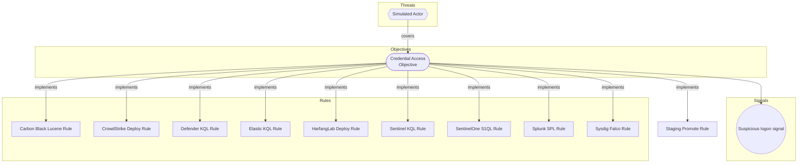

# Staging Promote Rule

## Metadata
| Field | Value |
| --- | --- |
| UUID | `00000000-0000-4000-8003-000000000008` |
| Schema | `rule::1.0` |
| Version | `2` |
| Created | `2026-01-01` |
| Modified | `2026-01-03` |
| TLP | clear (`TLP:CLEAR`) |

## Description
Rule with higher metadata.version for mutate/promote E2E tests.

## Status
| Field | Value |
| --- | --- |
| Status (sentinel) | `STAGING` |
| Severity | `Medium` |

## ATT&CK Techniques
| Technique | Name | Description |
| --- | --- | --- |
| `T1059` | [Command and Scripting Interpreter](https://attack.mitre.org/techniques/T1059) | Adversaries may abuse command and script interpreters to execute commands, scripts, or binaries. These interfaces and languages provide ways of interacting with computer systems and are a common feature across many different platforms. Most systems come with some built-in command-line interface and scripting capabilities, for example, macOS and Linux distributions include some flavor of [Unix Shell](https://attack.mitre.org/techniques/T1059/004) while Windows installations include the [Windows Command Shell](https://attack.mitre.org/techniques/T1059/003) and [PowerShell](https://attack.mitre.org/techniques/T1059/001).  There are also cross-platform interpreters such as [Python](https://attack.mitre.org/techniques/T1059/006), as well as those commonly associated with client applications such as [JavaScript](https://attack.mitre.org/techniques/T1059/007) and [Visual Basic](https://attack.mitre.org/techniques/T1059/005).  Adversaries may abuse these technologies in various ways as a means of executing arbitrary commands. Commands and scripts can be embedded in [Initial Access](https://attack.mitre.org/tactics/TA0001) payloads delivered to victims as lure documents or as secondary payloads downloaded from an existing C2. Adversaries may also execute commands through interactive terminals/shells, as well as utilize various [Remote Services](https://attack.mitre.org/techniques/T1021) in order to achieve remote Execution.(Citation: Powershell Remote Commands)(Citation: Cisco IOS Software Integrity Assurance - Command History)(Citation: Remote Shell Execution in Python) |

## Detection model
- **Objective**: [Credential Access Objective](../objectives/credential-access-objective.md) (`00000000-0000-4000-8002-000000000001`)

## Response

- **Alert severity**: Medium

## Platform configurations
<details><summary>sentinel</summary>

- **Enabled**: `True`
- **Status**: `STAGING`
- **Alert title**: Staging Promote Rule

```sql
SecurityEvent | take 1

```


</details>

## Coverage

## Related objects
| Type | Name | Direction | Relation |
| --- | --- | --- | --- |
| Objective | [Credential Access Objective](../objectives/credential-access-objective.md) (`00000000-0000-4000-8002-000000000001`) | Upstream | objective |
| Threat | [Simulated Actor](../threats/simulated-actor.md) (`00000000-0000-4000-8001-000000000001`) | Upstream | threat |
