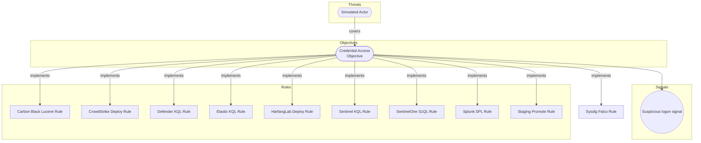

# Sysdig Falco Rule

## Metadata
| Field | Value |
| --- | --- |
| UUID | `00000000-0000-4000-8003-0000005d1a90` |
| Schema | `rule::1.0` |
| Version | `1` |
| Created | `2026-01-01` |
| Modified | `2026-01-02` |
| TLP | clear (`TLP:CLEAR`) |

## Description
Simulated Sysdig Secure Falco rule for CLI E2E corpus: a shell spawned in
a container.

## Status
| Field | Value |
| --- | --- |
| Status (sysdig) | `STAGING` |
| Severity | `Medium` |

## ATT&CK Techniques
| Technique | Name | Description |
| --- | --- | --- |
| `T1059.004` | [Command and Scripting Interpreter: Unix Shell](https://attack.mitre.org/techniques/T1059/004) | Adversaries may abuse Unix shell commands and scripts for execution. Unix shells are the primary command prompt on Linux, macOS, and ESXi systems, though many variations of the Unix shell exist (e.g. sh, ash, bash, zsh, etc.) depending on the specific OS or distribution.(Citation: DieNet Bash)(Citation: Apple ZShell) Unix shells can control every aspect of a system, with certain commands requiring elevated privileges.  Unix shells also support scripts that enable sequential execution of commands as well as other typical programming operations such as conditionals and loops. Common uses of shell scripts include long or repetitive tasks, or the need to run the same set of commands on multiple systems.  Adversaries may abuse Unix shells to execute various commands or payloads. Interactive shells may be accessed through command and control channels or during lateral movement such as with [SSH](https://attack.mitre.org/techniques/T1021/004). Adversaries may also leverage shell scripts to deliver and execute multiple commands on victims or as part of payloads used for persistence.  Some systems, such as embedded devices, lightweight Linux distributions, and ESXi servers, may leverage stripped-down Unix shells via Busybox, a small executable that contains a variety of tools, including a simple shell. |

## Detection model
- **Objective**: [Credential Access Objective](../objectives/credential-access-objective.md) (`00000000-0000-4000-8002-000000000001`)

## Response

- **Alert severity**: Medium

## Platform configurations

sysdig

- **Enabled**: `True`
- **Status**: `STAGING`

## Coverage

## Related objects
| Type | Name | Direction | Relation |
| --- | --- | --- | --- |
| Objective | [Credential Access Objective](../objectives/credential-access-objective.md) (`00000000-0000-4000-8002-000000000001`) | Upstream | objective |
| Threat | [Simulated Actor](../threats/simulated-actor.md) (`00000000-0000-4000-8001-000000000001`) | Upstream | threat |
