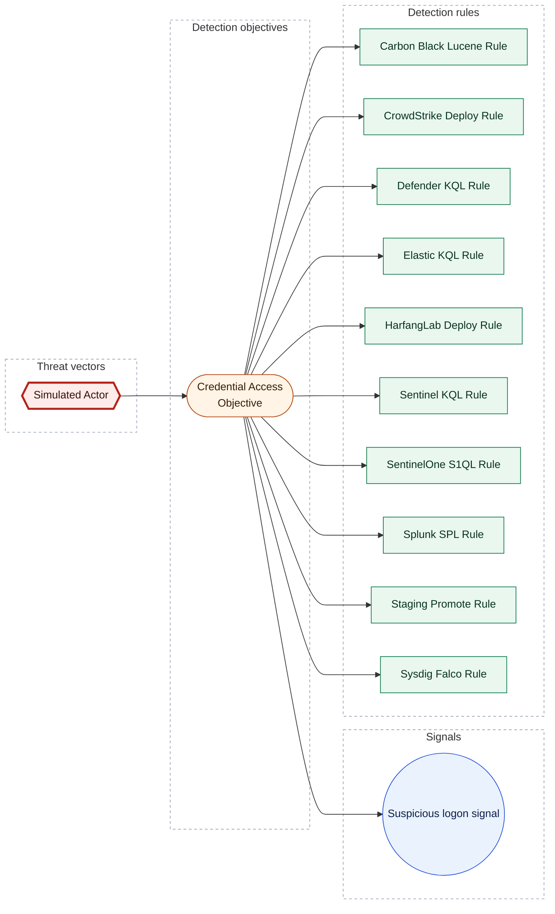

[Catalogue](../README.md) / [Threat vectors](README.md)

# Simulated Actor

*Threat vector · `threat::1.0` · version 1 · modified 2026-01-02 · TLP:CLEAR*

Simulated threat actor for CLI E2E corpus

| Property | Value |
| --- | --- |
| Criticality | High |
| Severity | Substantial incident |
| Surface | Windows::Desktop |
| Actors | [Enterprise] APT1 |
| ATT&CK | [`T1059`](https://attack.mitre.org/techniques/T1059) Command and Scripting Interpreter |
| CVE | 2 CVEs |
| Detection coverage | 1 objective, 10 rules |

**On this page:** [Assessment](#assessment) · [Surface](#surface) · [Actors](#actors) · [ATT&CK techniques](#att-ck-techniques) · [CVE](#cve) · [Detection coverage](#detection-coverage) · [Metadata](#metadata)

## Assessment

**Criticality: High**. A High priority incident is likely to result in a demonstrable impact to public health or safety, national security, economic security, foreign relations, civil liberties, or public confidence.

**Terrain:** Endpoint workstations and user devices.

| Dimension | Assessment | Description |
| --- | --- | --- |
| Severity | Substantial incident | A cyber attack which has a serious impact on a medium-sized organisation, or which poses a considerable risk to a large organisation or wider / local government. |
| Impact | Data Breach Identity Theft | Non-public information has been accessed from the outside, and successfully extracted. Acquisition of sufficient information and privileges to profess as a given individual, for the purpose of abusing and deceiving human trust relationships. |
| Leverage | Information Gathering Elevation of privilege | Gathering information about the target system, network, or environment to inform subsequent attack phases. Capacity to augment leverage over the target system by upgrading the compromised access rights |
| Viability | Likely | Probable (probably) - 55-80% |

## Surface

| Surface | Description |
| --- | --- |
| Windows::Desktop | Microsoft Windows desktop editions |

## Actors

| Actor | ID | Source | Description |
| --- | --- | --- | --- |
| [[Enterprise] APT1](https://attack.mitre.org/groups/G0006) *also Comment Crew, Comment Group, Comment Panda* | `att&ck::G0006` | att&ck | [APT1](https://attack.mitre.org/groups/G0006) is a Chinese threat group that has been attributed to the 2nd Bureau of the People’s Liberation Army (PLA) General Staff Department’s (GSD) 3rd Department, commonly known by its Military Unit… |

## ATT&CK techniques

| Technique | Name | Tactics | Detected by | Summary |
| --- | --- | --- | --- | --- |
| [`T1059`](https://attack.mitre.org/techniques/T1059) | Command and Scripting Interpreter | Execution | [Carbon Black Lucene Rule](../rules/carbon-black-lucene-rule.md) [CrowdStrike Deploy Rule](../rules/crowdstrike-deploy-rule.md) [Defender KQL Rule](../rules/defender-kql-rule.md) [Elastic KQL Rule](../rules/elastic-kql-rule.md) [HarfangLab Deploy Rule](../rules/harfanglab-deploy-rule.md) [Sentinel KQL Rule](../rules/sentinel-kql-rule.md) [SentinelOne S1QL Rule](../rules/sentinelone-s1ql-rule.md) [Splunk SPL Rule](../rules/splunk-spl-rule.md) [Staging Promote Rule](../rules/staging-promote-rule.md) [Sysdig Falco Rule](../rules/sysdig-falco-rule.md) | Adversaries may abuse command and script interpreters to execute commands, scripts, or binaries. |

## CVE

Identifiers link to [CIRCL Vulnerability-Lookup](https://vulnerability.circl.lu), which aggregates CVE, GHSA, CSAF, NVD, and related feeds.

| Identifier | Severity | EPSS | Exploitation | Weakness | Published |
| --- | --- | --- | --- | --- | --- |
| [CVE-2024-3094](https://vulnerability.circl.lu/vuln/CVE-2024-3094) | - | - | - | - | Details unavailable from Vulnerability-Lookup. |
| [GHSA-rxwq-x6h5-qc8m](https://vulnerability.circl.lu/vuln/GHSA-rxwq-x6h5-qc8m) | - | - | - | - | Details unavailable from Vulnerability-Lookup. |

Vulnerability-Lookup was unreachable for at least one identifier; links still point at the CIRCL record page.

*EPSS: FIRST's probability of exploitation in the next 30 days. Exploitation: CISA's Known Exploited Vulnerabilities catalog, else its SSVC assessment.*

## Detection coverage

*Shapes:* hexagon = threat vector; stadium = detection objective; circle = detection signal; rectangle = detection rule; bold outline = this page.

### Related objects

| Type | Object | Direction |
| --- | --- | --- |
| Objective | [Credential Access Objective](../objectives/credential-access-objective.md) | Downstream |
| Signal | [Suspicious logon signal](../objectives/credential-access-objective.md#suspicious-logon-signal) | Downstream |
| Rule | [Carbon Black Lucene Rule](../rules/carbon-black-lucene-rule.md) | Downstream |
| Rule | [CrowdStrike Deploy Rule](../rules/crowdstrike-deploy-rule.md) | Downstream |
| Rule | [Defender KQL Rule](../rules/defender-kql-rule.md) | Downstream |
| Rule | [Elastic KQL Rule](../rules/elastic-kql-rule.md) | Downstream |
| Rule | [HarfangLab Deploy Rule](../rules/harfanglab-deploy-rule.md) | Downstream |
| Rule | [Sentinel KQL Rule](../rules/sentinel-kql-rule.md) | Downstream |
| Rule | [SentinelOne S1QL Rule](../rules/sentinelone-s1ql-rule.md) | Downstream |
| Rule | [Splunk SPL Rule](../rules/splunk-spl-rule.md) | Downstream |
| Rule | [Staging Promote Rule](../rules/staging-promote-rule.md) | Downstream |
| Rule | [Sysdig Falco Rule](../rules/sysdig-falco-rule.md) | Downstream |

## Metadata

| Field | Value |
| --- | --- |
| UUID | `00000000-0000-4000-8001-000000000001` |
| Schema | `threat::1.0` |
| Version | `1` |
| Created | `2026-01-01` |
| Modified | `2026-01-02` |
| TLP | clear (`TLP:CLEAR`) |

<!-- Generated by opentide (opentide generate docs). Edit the object's YAML instead: this page is rewritten on every run. -->
