# Simulated Actor

## Metadata
| Field | Value |
| --- | --- |
| UUID | `00000000-0000-4000-8001-000000000001` |
| Schema | `threat::1.0` |
| Version | `1` |
| Created | `2026-01-01` |
| Modified | `2026-01-02` |
| TLP | clear (`TLP:CLEAR`) |

## Description
Simulated threat actor for CLI E2E corpus

## Criticality
**High** - A High priority incident is likely to result in a demonstrable impact to public health or safety, national security, economic security, foreign relations, civil liberties, or public confidence.

## Terrain
Endpoint workstations and user devices.

## Surface
> **Windows::Desktop**
> Microsoft Windows desktop editions

## Threat Assessment
| Dimension | Assessment | Description |
| --- | --- | --- |
| Severity | Substantial incident | A cyber attack which has a serious impact on a medium-sized organisation, or which poses a considerable risk to a large organisation or wider / local government. |
| Impact | Data Breach Identity Theft | Non-public information has been accessed from the outside, and successfully extracted. Acquisition of sufficient information and privileges to profess as a given individual, for the purpose of abusing and deceiving human trust relationships. |
| Leverage | Information Gathering Elevation of privilege | Gathering information about the target system, network, or environment to inform subsequent attack phases. Capacity to augment leverage over the target system by upgrading the compromised access rights |
| Viability | Likely | Probable (probably) - 55-80% |

## Actors
| Actor | ID | Source | Description |
| --- | --- | --- | --- |
| [[Enterprise] APT1](https://attack.mitre.org/groups/G0006) | `att&ck::G0006` | att&ck | [APT1](https://attack.mitre.org/groups/G0006) is a Chinese threat group that has been attributed to the 2nd Bureau of the People’s Liberation Army (PLA) General Staff Department’s (GSD) 3rd Department, commonly known by its Military Unit Cover Designator (MUCD) as Unit 61398. (Citation: Mandiant APT1) |

## CVE
Identifiers link to [CIRCL Vulnerability-Lookup](https://vulnerability.circl.lu), which aggregates CVE, GHSA, CSAF, NVD, and related feeds.

| Identifier | Published | Severity | Summary |
| --- | --- | --- | --- |
| [CVE-2024-3094](https://vulnerability.circl.lu/vuln/CVE-2024-3094) | - | - | Details unavailable from Vulnerability-Lookup. |
| [GHSA-rxwq-x6h5-qc8m](https://vulnerability.circl.lu/vuln/GHSA-rxwq-x6h5-qc8m) | - | - | Details unavailable from Vulnerability-Lookup. |

Vulnerability-Lookup was unreachable for at least one identifier; links still point at the CIRCL record page.

## ATT&CK Techniques
| Technique | Name | Description |
| --- | --- | --- |
| `T1059` | [Command and Scripting Interpreter](https://attack.mitre.org/techniques/T1059) | Adversaries may abuse command and script interpreters to execute commands, scripts, or binaries. These interfaces and languages provide ways of interacting with computer systems and are a common feature across many different platforms. Most systems come with some built-in command-line interface and scripting capabilities, for example, macOS and Linux distributions include some flavor of [Unix Shell](https://attack.mitre.org/techniques/T1059/004) while Windows installations include the [Windows Command Shell](https://attack.mitre.org/techniques/T1059/003) and [PowerShell](https://attack.mitre.org/techniques/T1059/001).  There are also cross-platform interpreters such as [Python](https://attack.mitre.org/techniques/T1059/006), as well as those commonly associated with client applications such as [JavaScript](https://attack.mitre.org/techniques/T1059/007) and [Visual Basic](https://attack.mitre.org/techniques/T1059/005).  Adversaries may abuse these technologies in various ways as a means of executing arbitrary commands. Commands and scripts can be embedded in [Initial Access](https://attack.mitre.org/tactics/TA0001) payloads delivered to victims as lure documents or as secondary payloads downloaded from an existing C2. Adversaries may also execute commands through interactive terminals/shells, as well as utilize various [Remote Services](https://attack.mitre.org/techniques/T1021) in order to achieve remote Execution.(Citation: Powershell Remote Commands)(Citation: Cisco IOS Software Integrity Assurance - Command History)(Citation: Remote Shell Execution in Python) |

## Coverage

```mermaid
flowchart TB
subgraph "Objectives"
00000000_0000_4000_8002_000000000001(["Credential Access<br>Objective"])
end
subgraph "Signals"
00000000_0000_4000_8099_000000000001(("Suspicious logon signal"))
end
subgraph "Rules"
00000000_0000_4000_8003_000000000005["Carbon Black Lucene Rule"]
00000000_0000_4000_8003_000000000006["CrowdStrike Deploy Rule"]
00000000_0000_4000_8003_000000000002["Defender KQL Rule"]
00000000_0000_4000_8003_000000000009["Elastic KQL Rule"]
00000000_0000_4000_8003_000000000007["HarfangLab Deploy Rule"]
00000000_0000_4000_8003_000000000001["Sentinel KQL Rule"]
00000000_0000_4000_8003_000000000004["SentinelOne S1QL Rule"]
00000000_0000_4000_8003_000000000003["Splunk SPL Rule"]
00000000_0000_4000_8003_000000000008["Staging Promote Rule"]
00000000_0000_4000_8003_0000005d1a90["Sysdig Falco Rule"]
end
00000000_0000_4000_8001_000000000001{{"Simulated Actor"}}
00000000_0000_4000_8001_000000000001 -->|covers| 00000000_0000_4000_8002_000000000001
00000000_0000_4000_8002_000000000001 --> 00000000_0000_4000_8099_000000000001
00000000_0000_4000_8002_000000000001 -->|implements| 00000000_0000_4000_8003_000000000005
00000000_0000_4000_8002_000000000001 -->|implements| 00000000_0000_4000_8003_000000000006
00000000_0000_4000_8002_000000000001 -->|implements| 00000000_0000_4000_8003_000000000002
00000000_0000_4000_8002_000000000001 -->|implements| 00000000_0000_4000_8003_000000000009
00000000_0000_4000_8002_000000000001 -->|implements| 00000000_0000_4000_8003_000000000007
00000000_0000_4000_8002_000000000001 -->|implements| 00000000_0000_4000_8003_000000000001
00000000_0000_4000_8002_000000000001 -->|implements| 00000000_0000_4000_8003_000000000004
00000000_0000_4000_8002_000000000001 -->|implements| 00000000_0000_4000_8003_000000000003
00000000_0000_4000_8002_000000000001 -->|implements| 00000000_0000_4000_8003_000000000008
00000000_0000_4000_8002_000000000001 -->|implements| 00000000_0000_4000_8003_0000005d1a90
```

## Related objects
| Type | Name | Direction | Relation |
| --- | --- | --- | --- |
| Objective | [Credential Access Objective](../objectives/credential-access-objective.md) (`00000000-0000-4000-8002-000000000001`) | Downstream | objective |
| Signal | [Suspicious logon signal](../objectives/credential-access-objective.md#suspicious-logon-signal) (`00000000-0000-4000-8099-000000000001`) | Downstream | signal |
| Rule | [Sentinel KQL Rule](../rules/sentinel-kql-rule.md) (`00000000-0000-4000-8003-000000000001`) | Downstream | rule |
| Rule | [Defender KQL Rule](../rules/defender-kql-rule.md) (`00000000-0000-4000-8003-000000000002`) | Downstream | rule |
| Rule | [Splunk SPL Rule](../rules/splunk-spl-rule.md) (`00000000-0000-4000-8003-000000000003`) | Downstream | rule |
| Rule | [SentinelOne S1QL Rule](../rules/sentinelone-s1ql-rule.md) (`00000000-0000-4000-8003-000000000004`) | Downstream | rule |
| Rule | [Carbon Black Lucene Rule](../rules/carbon-black-lucene-rule.md) (`00000000-0000-4000-8003-000000000005`) | Downstream | rule |
| Rule | [CrowdStrike Deploy Rule](../rules/crowdstrike-deploy-rule.md) (`00000000-0000-4000-8003-000000000006`) | Downstream | rule |
| Rule | [HarfangLab Deploy Rule](../rules/harfanglab-deploy-rule.md) (`00000000-0000-4000-8003-000000000007`) | Downstream | rule |
| Rule | [Staging Promote Rule](../rules/staging-promote-rule.md) (`00000000-0000-4000-8003-000000000008`) | Downstream | rule |
| Rule | [Elastic KQL Rule](../rules/elastic-kql-rule.md) (`00000000-0000-4000-8003-000000000009`) | Downstream | rule |
| Rule | [Sysdig Falco Rule](../rules/sysdig-falco-rule.md) (`00000000-0000-4000-8003-0000005d1a90`) | Downstream | rule |
